# RHEL Image Pipeline - Technical Approach

## Executive Summary

The image pipeline produces hardened RHEL golden images on AWS. Each image is built start-to-finish by
`osbuild-composer` (Red Hat Image Builder) on a dedicated builder EC2 instance. A TOML blueprint declares the full
image specification: packages, FIPS mode, STIG profile, partition layout, and cloud-init configuration. The compose
produces a hardened qcow2 directly; no guest VM is booted, no SSH session is opened, and no post-install remediation
step is needed.

After the compose, the qcow2 is validated offline: `guestmount` mounts the image read-only and `oscap-chroot` runs
a DISA STIG assessment against the filesystem. The scan evaluates the actual artifact that ships. The qcow2 is then
converted to cloud-native formats (`qcow2 -> raw -> AMI` for AWS) and distributed to target accounts.

The RHEL pipeline shares builder infrastructure, AAP orchestration, Artifactory artifact packaging, AMI distribution,
IAM role separation, and inventory architecture with the Windows pipeline. RHEL-specific work is confined to the
blueprint templates, the hardening/scan role, and the cloud format conversion step.

Key recommendations are recorded as Architecture Decision Records (ADRs). See the
[ADR Reference Table](#adr-reference-table) at the end of this document.

| Attribute            | Value                                                                      |
|----------------------|----------------------------------------------------------------------------|
| **Current delivery** | RHEL 8.10, 9.4, 9.6, 9.8; AWS; base + poc profiles                         |
| **Build tool**       | osbuild-composer (Red Hat Image Builder)                                   |
| **Hardening**        | OpenSCAP via `[customizations.openscap]` in the blueprint                  |
| **Compliance scan**  | `oscap-chroot` offline scan (DISA STIG datastream)                         |
| **Orchestration**    | AAP Controller workflow                                                    |
| **Artifacts**        | JFrog Artifactory Release Bundles (XML/HTML scan results + AMI metadata)   |

---

## Shared Infrastructure

The RHEL pipeline was the first implementation. The shared components below were built for RHEL and are reused
by Windows with zero or minimal additional work.
[WINDOWS-APPROACH.md § Shared Infrastructure](WINDOWS-APPROACH.md#shared-infrastructure-rhel-parity) records
the Windows-side view; this section is the authoritative reference.

**Builder EC2 lifecycle** (`builder_configure`, `start_builders`, `stop_builders`): managed EC2 hosts run both
osbuild-composer (RHEL) and Packer (Windows). The `builder_configure` role installs different tooling depending
on which child group the host belongs to: `osbuild_builders` get osbuild-composer, composer-cli, and OpenSCAP;
`packer_builders` get Packer. Both builder types share work directories (`builder_work_dir`,
`image_output_dir`, `report_output_dir`). Start and stop playbooks run on localhost, finding builders by EC2
tag (`purpose: image-builder`) via the AWS API. Individual start/configure failures are logged and excluded;
the pipeline continues as long as at least one builder per type is healthy.

**AAP Controller workflow** (`Image Build Pipeline`): runs Build RHEL and Build Windows as parallel sibling
nodes, with shared Configure, Distribute, Start, and Stop steps. Adding Windows to the workflow was one
workflow node and one job template. Build failures in one branch do not block the other; both branches use
`always_nodes` to reach Distribute, and Distribute uses `all_parents_must_converge` to wait for both before
proceeding. Stop Builders runs regardless of build outcomes. An ephemeral variant (`Image Build Pipeline
(Ephemeral)`) replaces Start/Stop with Provision/Teardown for fully disposable builder instances (ADR-020).

**Artifactory Release Bundles** (`image_export` / `image_release_publish` + `artifactory_release_bundle`): the
same `artifactory_release_bundle` role packages compliance evidence for both RHEL (OpenSCAP XML/HTML) and
Windows (PowerSTIG JSON/HTML) as immutable Release Bundles v2. The role creates a bundle via Artifactory's
lifecycle API, grouping every artifact under the target's `vm_name/build_timestamp` path. If a GPG signing
key is configured (`release_bundle_signing_key`), the bundle is signed after creation. RHEL bundles include
the compressed qcow2 image alongside scan results; Windows bundles contain only scan results and metadata
(the AMI is the Packer output, not a file artifact).

**AMI distribution** (`image_distribute`): cross-region AMI copy and cross-account share. Same role and logic
for RHEL-converted AMIs and Windows Packer AMIs. The role dispatches to provider-specific task files based on
`cloud_targets` (AWS implemented; Azure and GCP are placeholder task files). The distribution pattern
(ADR-028) shares the AMI with target accounts, which then copy it into a locally-owned AMI for operational
independence.

**AMI cleanup** (`ami_cleanup`): deregisters old AMIs and their backing EBS snapshots per phantom host.
Retention is controlled by `ami_cleanup_keep_count` (keep last N per host per region) and
`ami_cleanup_older_than` (delete AMIs created before a date). Supports `--check` for dry runs. Dispatches to
provider-specific task files, same as distribution and conversion.

**Inventory architecture** (ADR-017): phantom hosts with four-dimension group-based variable merge and
`delegate_to` real builders. The four dimensions are:

1. **OS family** (`rhel8_targets`, `rhel9_targets`, `windows_targets`): determines blueprint template, STIG
   datastream/profile, and platform-specific tooling choices.
2. **OS version** (`rhel_8_10`, `rhel_9_4`, `rhel_9_6`, `rhel_9_8`, `windows_2022`, `windows_2025`):
   determines the specific release within a family. For RHEL, this is the minor version since the major lives
   in dimension 1. For Windows, this is the LTSC release year.
3. **Profile** (`profile_base`, `profile_poc`   ): determines workload-specific packages, features, and
   configuration overlays. Profiles use a composition system: common config lives in
   `group_vars/all_profiles/*.yml` as `_base_*` vars, and each profile adds extras via
   `_profile_specific_*` vars. The final `profile_*` variables consumed by roles are Jinja expressions that
   concatenate both layers automatically.
4. **Build method** (`method_osbuild`, `method_packer`): determines which builder type runs the build. This
   is also the routing dimension: `method_osbuild.yml` sets `builder_group: osbuild_builders`;
   `method_packer.yml` sets `builder_group: packer_builders`. Build roles assign each phantom host to a real
   builder via round-robin across the builder group, and all downstream roles inherit that assignment.

Each phantom host belongs to one group in each dimension; Ansible merges variables from all of them. Adding a
new image variant requires only a new entry in `targets.yml` and any needed `group_vars` files; no playbook
or role changes. Source: `inventory/targets.yml`, `inventory/group_vars/`.

**Secrets** (ADR-006): HashiCorp Vault. Credentials (AWS, Artifactory, WinRM bootstrap password) are injected
at runtime by AAP/Vault as extra-vars or environment variables. The `all.yml` group vars define per-function
credential overrides (`aws_build_*`, `aws_distribute_*`, `aws_cleanup_*`, `artifactory_token_*`) that default
to a shared credential, enabling least-privilege IAM role separation (ADR-029) without changing any role code.
Windows adds one credential (`windows_winrm` for Packer WinRM authentication); everything else is shared.

**IAM role separation** (ADR-029): per-function AWS credentials for build, distribute, and cleanup operations.
Today all pipeline functions use a single identity. To split later, override only the function-specific
variants in `all.yml` (e.g., `aws_distribute_access_key_id`). No role code changes needed.

---

## Build Matrix

The inventory defines RHEL build targets as phantom hosts across four dimensions. Each host belongs to multiple
groups; Ansible merges variables from all of them.

| Target           | OS Version | Profile        | Build Method     |
|------------------|------------|----------------|------------------|
| `rhel-8.10-base` | `rhel_8_10`| `profile_base` | `method_osbuild` |
| `rhel-8.10-poc`  | `rhel_8_10`| `profile_poc`  | `method_osbuild` |
| `rhel-9.4-base`  | `rhel_9_4` | `profile_base` | `method_osbuild` |
| `rhel-9.4-poc`   | `rhel_9_4` | `profile_poc`  | `method_osbuild` |
| `rhel-9.6-base`  | `rhel_9_6` | `profile_base` | `method_osbuild` |
| `rhel-9.6-poc`   | `rhel_9_6` | `profile_poc`  | `method_osbuild` |
| `rhel-9.8-base`  | `rhel_9_8` | `profile_base` | `method_osbuild` |
| `rhel-9.8-poc`   | `rhel_9_8` | `profile_poc`  | `method_osbuild` |

Per-profile customization (packages, filesystem layout overrides) is applied via the profile composition system,
which merges a base layer (`_base_linux_*`) with profile-specific overrides (`_profile_specific_linux_*`)
automatically. Adding a new profile requires only new group vars and an inventory entry; no playbook or role changes.

RHEL minor releases (9.4 vs. 9.6 vs. 9.8) are distinct base images with distinct OS version groups. Each
major version (RHEL 8 vs. RHEL 9) has its own blueprint template, STIG datastream, and package ecosystem.

Source: `inventory/targets.yml`, `inventory/group_vars/`.

---

## Source Images

Unlike the Windows pipeline (which starts from a marketplace AMI), RHEL images are composed from scratch by
osbuild-composer. The builder host pulls packages from Red Hat CDN (or a Satellite / Artifactory RPM mirror) and
assembles the qcow2 according to the blueprint. There is no pre-existing base image to source.

The blueprint declares everything the image contains: packages, partition layout, FIPS mode, STIG profile,
cloud-init configuration, firewall rules, and service enablement. The compose is deterministic; the same blueprint
and repos produce the same image.

This means the RHEL pipeline has no "source AMI discovery" concern. The equivalent decision is which RHEL content
repos the builder uses, which is a subscription and content-sourcing question.

---

## Build Process

Ansible templates the osbuild-composer TOML blueprint at build time using Jinja2. There are no static `.toml` files
checked in; the templates are rendered per-target with values from inventory group vars.

Templates in `roles/rhel_image_build/templates/`:

| Template                  | Purpose                                                            |
|---------------------------|---------------------------------------------------------------------|
| `rhel-blueprint.toml.j2` | RHEL blueprint: packages, FIPS, STIG, partitions, cloud-init       |

The build process:

```
1. Template blueprint          (Jinja2 -> TOML, per-target)
2. Push blueprint              (composer-cli blueprints push)
3. Start compose               (composer-cli compose start <name> qcow2)
4. Wait for compose            (poll until complete)
5. Download qcow2              (composer-cli compose image <uuid>)
6. Fix RHEL 8 fstab            (RHEL 8 only: patch inode64 and stale /proc/cmdline mount)
7. Verify FIPS offline         (guestmount + check crypto-policies and kernel cmdline)
8. Run compliance scan offline (guestmount + oscap-chroot)
9. Prepare cloud-init          (post-compose offline customizations, if needed)
10. Export to Artifactory       (compress qcow2 + scan results + metadata + Release Bundle)
11. Convert to cloud format     (qcow2 -> raw -> AMI via ec2:ImportImage)
12. Distribute                  (cross-region copy, cross-account share)
```

The outer Ansible run (on the builder host) performs all steps. There is no guest VM, no SSH session, no
nested virtualization. The builder instance runs osbuild-composer natively. This is fundamentally different from
the Windows pipeline, where Packer launches and connects to a temporary guest.

The `rhel_image_build` role assigns each phantom host to a builder via round-robin. All downstream roles
(hardening, export, convert, distribute) inherit the same builder assignment, ensuring the builder that composed
the qcow2 is the same one that scans, exports, and converts it.

---

## FIPS 140-3 Enablement

FIPS **must** be enabled at compose time on RHEL. This is a non-negotiable architectural requirement, not a
preference. The blueprint enables it:

```toml
[customizations.fips]
enabled = true

[customizations.kernel]
append = "fips=1 console=ttyS0,115200n8"
```

The `console=ttyS0,115200n8` parameter directs kernel boot output to the first serial port at 115200 baud, 8N1. All
three target clouds (AWS, Azure, GCP) present their serial console on `ttyS0` at this baud rate, so no
cloud-specific kernel parameter is needed.

The resulting image has never booted without FIPS. Every cryptographic key generated from the first boot cycle is
FIPS-compliant. There is no tainted key window.

### Why Compose-Time Enablement Is Required on RHEL

RHEL has a pluggable cryptographic architecture with multiple independent libraries (OpenSSL, GnuTLS, libgcrypt, NSS,
kernel crypto subsystem), each with its own FIPS validation. When RHEL boots without `fips=1`:

- **SSH host keys** may be generated with non-FIPS algorithms (e.g., Ed25519) using OpenSSL's `default` provider
  instead of `fips.so`.
- **LUKS disk encryption** uses Argon2 as the default KDF. Argon2 is not FIPS-approved. A LUKS volume created with
  Argon2 cannot be decrypted in FIPS mode; the system may become unbootable.
- **The kernel crypto subsystem** does not run self-tests. `/proc/sys/crypto/fips_enabled` reads `0`.

These keys are generated once and persist. They cannot be retroactively made compliant. Red Hat's documentation states
this explicitly:

> "Only enabling FIPS mode during the RHEL installation ensures that the system generates all keys with
> FIPS-approved algorithms and continuous monitoring tests in place."
>
> [RHEL 9 Security Hardening Guide, Chapter 3](https://docs.redhat.com/en/documentation/red_hat_enterprise_linux/9/html/security_hardening/switching-rhel-to-fips-mode_security-hardening)

The stronger warning:

> "Switching the system to FIPS mode by using the `fips-mode-setup` tool does not guarantee compliance with the FIPS 140
> standard. Re-generating all cryptographic keys after setting the system to FIPS mode may not be possible."

This is why the pipeline uses `[customizations.fips] enabled = true` in the blueprint: the image is FIPS-compliant from
creation, with no window where non-FIPS keys can exist.

### Contrast with Windows

Windows has a centralized cryptographic architecture (CNG) where the same CMVP-validated modules perform all operations
regardless of the FIPS mode flag. FIPS mode is a runtime policy gate enabled via registry key; there is no "tainted
key" risk. See
[WINDOWS-APPROACH.md § FIPS 140-3 Enablement](WINDOWS-APPROACH.md#fips-140-3-enablement-why-windows-and-rhel-differ)
for the full comparison.

---

## STIG Hardening

STIG remediation is applied during the osbuild-composer compose via the blueprint's `[customizations.openscap]`
section. Image Builder runs pre-first-boot remediation using the `scap-security-guide` datastream. The resulting image
is STIG-compliant from the moment the compose completes.

```toml
[customizations.openscap]
datastream = "/usr/share/xml/scap/ssg/content/ssg-rhel9-ds.xml"
profile_id = "xccdf_org.ssgproject.content_profile_stig"
```

This is fundamentally different from the Windows approach:

| Attribute                  | RHEL                                              | Windows                                        |
|----------------------------|---------------------------------------------------|-------------------------------------------------|
| When STIG is applied       | During compose (pre-first-boot)                   | Post-boot via Ansible (MindPoint collection)   |
| Guest VM required          | No                                                | Yes (Packer launches a temporary EC2 instance) |
| Hardening tool             | Image Builder + `scap-security-guide`             | MindPoint Group Ansible collection             |
| Unhardened window          | None; image is hardened from creation             | Build-time window while Packer provisions      |
| Per-rule toggles           | `stig_unselected_rules` in blueprint tailoring    | `wn22_*_enabled` MindPoint variables           |

### Advantages of Compose-Time Hardening

- **Hardened from creation.** No window where an unhardened artifact exists on the builder.
- **No KVM required.** osbuild-composer builds images natively without nested virtualization.
- **No guest interaction.** No SSH, no idle timeout issues, no guest networking.
- **Deterministic.** The same blueprint and repos produce the same image.
- **Red Hat-supported integration.** Image Builder's OpenSCAP support is a first-party feature.

### Trade-offs

**Reduced debuggability.** If a STIG rule causes problems, the compose may succeed but produce a subtly broken image
(e.g., fapolicyd blocking cloud-init on first boot). Discovery happens when the image fails to boot in a cloud
environment. Debugging requires mounting the image and inspecting logs.

**Tailoring limitations.** Blueprint tailoring uses `selected` / `unselected` rule arrays. This cannot set
`<xccdf:refine-value>` overrides (e.g., changing a password minimum length parameter). For complex tailoring, use
`[customizations.openscap.json_tailoring]` with a JSON tailoring file injected via `[[customizations.files]]`.

---

## STIG Exception Management

RHEL STIG rule modifications follow a GitOps model (ADR-010) and are managed via the `stig_unselected_rules` list in
family group vars (`rhel8_targets.yml`, `rhel9_targets.yml`).

```yaml
# group_vars/rhel9_targets.yml
stig_unselected_rules: []
#   - aide_build_database
#   - timer_dnf-automatic_enabled
```

Each deselected rule should have a documented justification. The change goes through the standard merge request
approval process.

### Controls Commonly Tailored for Cloud Images

| Control area      | Rule ID prefix                | Why it's tailored              | Recommended action              |
|-------------------|-------------------------------|--------------------------------|---------------------------------|
| AIDE database     | `aide_build_database`         | Database must be initialized   | Unselect; initialize AIDE on    |
|                   |                               | after all changes are          | first boot via cloud-init       |
|                   |                               | complete; Image Builder's      |                                 |
|                   |                               | remediation timing may         |                                 |
|                   |                               | conflict                       |                                 |
| Automatic updates | `timer_dnf-automatic_enabled` | Can trigger during image       | Unselect; enable via cloud-init |
|                   |                               | creation or first boot         | after instance is stable        |
|                   |                               | unexpectedly                   |                                 |
| fapolicyd         | `fapolicyd_*`                 | Verify Image Builder correctly | Usually safe to leave selected; |
|                   |                               | trusts cloud-init and its      | test thoroughly                 |
|                   |                               | dependencies                   |                                 |
| SSH idle timeout  | `sshd_*_idle_timeout`         | Not relevant during build (no  | Usually safe to leave selected  |
|                   |                               | SSH); verify cloud-init        |                                 |
|                   |                               | survives post-deploy           |                                 |

No permanent exceptions are active in the current RHEL builds. The `stig_unselected_rules` lists are empty, pending
security team review.

The governance philosophy (code change + justification + MR approval) mirrors the Windows exception process (ADR-030).
The mechanism differs: `stig_unselected_rules` in OpenSCAP blueprint tailoring vs. MindPoint per-rule toggle variables
in Ansible inventory. The two processes are documented in separate ADRs because the artifacts, tooling, and audit
evidence are OS-specific.

---

## Compliance Scanning

### Offline Scan (oscap-chroot)

The `rhel_hardening` role validates the composed image by mounting it read-only via `guestmount` and running
`oscap-chroot` against the filesystem. This produces:

- `<vm_name>-oscap-results.xml` (XCCDF results: per-rule pass/fail/not-applicable)
- `<vm_name>-oscap-report.html` (color-coded summary table)

Both are uploaded to Artifactory and included in the release bundle.

### Why One Scan Is Sufficient

The RHEL pipeline runs one compliance scan; the Windows pipeline runs two (pre-seal + post-AMI). This is not an
inconsistency; it reflects a fundamental architectural difference. See
[WINDOWS-APPROACH.md § Why Two Scans](WINDOWS-APPROACH.md#why-two-scans-for-windows-but-one-for-rhel)
for the full comparison.

The short version: the `oscap-chroot` scan target IS the shipped artifact.

The compose produces a qcow2 on the builder host. Cloud conversion (`qcow2 -> raw -> AMI`) is a format transformation:
the same bits are repackaged into a different container, but the filesystem contents are identical. There is no
Sysprep-equivalent step, no generalization pass that modifies configuration, and no deferred-rule re-application. The
qcow2 after the compose is the same qcow2 after the scan, and the same bits inside the AMI.

One scan is sufficient because the scan target and the shipped artifact are the same object.

### Offline Scan Caveats

`oscap-chroot` scans the mounted filesystem. Some STIG rules cannot be evaluated offline because they require a running
system:

| Rule category          | Why it fails offline           | Impact                        |
|------------------------|--------------------------------|-------------------------------|
| Process/service checks | No running services to inspect | Rule reports "not applicable" |
| Network configuration  | No active interfaces           | Rule reports "not applicable" |
| Audit daemon status    | auditd not running             | Rule reports "not applicable" |
| Login session limits   | No active sessions             | Rule reports "not applicable" |

These rules ARE applied by Image Builder during the compose. They cannot be *verified* offline. `oscap-chroot` returns
exit code 2 ("some rules not applicable"), which the pipeline accepts as expected.

Full runtime verification of RHEL images requires booting a test instance, which is outside the current pipeline scope.
This is a coverage gap, not a correctness gap; the scan is still evaluating the correct artifact.

### FIPS Verification (Offline)

In addition to the STIG scan, the `rhel_hardening` role performs offline FIPS verification by mounting the qcow2 and
checking:

1. `/etc/crypto-policies/state/current` contains `FIPS`
2. Kernel boot entries contain `fips=1`

This catches FIPS configuration failures before the image enters the conversion pipeline.

---

## STIG Benchmark Version Lifecycle

DISA publishes updated STIG benchmarks quarterly (roughly January, April, July, October). Each release may add new
rules, remove deprecated rules, change check logic, or update variable defaults. The `scap-security-guide` (SSG)
package that ships the benchmark datastreams is updated on a similar cadence.

When a new benchmark drops:

- Existing images are compliant against the **old** benchmark but may have new findings against the new one.
- Tailoring rules may reference rule IDs that were renamed or removed.
- Compliance reports generated against the old benchmark are still valid evidence for the period they covered, but new
  builds should target the new benchmark.

### 1. Pin the SSG Package Version per OS Release

Each OS version's `group_vars` file should pin the `scap-security-guide` package version used for both hardening and
scanning. This ensures builds are reproducible and that the benchmark version is an explicit, version-controlled
decision, not an accident of `dnf update` timing.

```yaml
# group_vars/rhel_9_8.yml (example)
_stig_ssg_version: "0.1.75"
```

When a new SSG version is released, update the pinned version deliberately, after validation, not automatically.

### 2. Adopt New Benchmarks on a Deliberate Cycle

**Do not auto-adopt new benchmarks.** Treat a benchmark update as a change that flows through a validation pipeline:

1. **Monitor:** Subscribe to DISA STIG announcements and `scap-security-guide` release notifications. Assign an owner
   for this.
2. **Evaluate:** When a new benchmark is published, diff the rule set against the current pinned version. Identify new
   rules, removed rules, and changed defaults. Tools: `oscap info --profiles` and
   `diff <(oscap info old-ds.xml) <(oscap info new-ds.xml)`.
3. **Update tailoring:** If new rules conflict with the image's function (e.g., a new rule breaks cloud-init), add them
   to the blueprint's `stig_unselected_rules` list with a documented justification and waiver reference.
4. **Rebuild and scan:** Run the full build matrix against the new benchmark. Compare scan results to the previous
   benchmark's results.
5. **Promote:** Once scan results are reviewed and any new tailoring is approved, merge the updated `group_vars` and
   tailoring. All subsequent builds use the new benchmark.

**Target turnaround:** Complete the evaluation-through-promotion cycle within **30 days** of a new benchmark release.
This gives a reasonable adoption window without letting the pipeline fall multiple quarters behind.

### 3. Rebuild Cadence after Adoption

A new benchmark does **not** trigger an immediate emergency rebuild of every image in the matrix. The recommended flow:

- **Next scheduled build** after the benchmark update is merged automatically picks it up.
- If builds are infrequent (e.g., monthly), consider triggering an ad-hoc full-matrix build after merging the update so
  that compliant images are available promptly.
- Existing images in target accounts remain valid under the old benchmark until they are replaced. Compliance posture
  is "compliant as of the benchmark version the image was built against," which is standard practice.

### 4. Track Benchmark Version in Build Metadata

Every release bundle should include the SSG version and benchmark ID in its metadata. This makes it possible to answer
"which benchmark was this image built against?" without re-scanning.

```yaml
# Example metadata fields (already partially covered by build_metadata role)
stig_benchmark_id: "xccdf_org.ssgproject.content_benchmark_RHEL-9"
stig_profile_id: "xccdf_org.ssgproject.content_profile_stig"
ssg_version: "0.1.75"
```

### 5. Handle the RHEL 8 / RHEL 9 Benchmark Split

RHEL 8 and RHEL 9 use different STIG benchmarks (different datastream files, different rule sets, different check
logic). A new quarterly release may update one and not the other, or update both with different changes. The evaluation
step (item 2 above) must be done **per OS major version**, not once for all RHEL.

The inventory already reflects this split:

- `rhel8_targets.yml`: `stig_datastream: "ssg-rhel8-ds.xml"`
- `rhel9_targets.yml`: `stig_datastream: "ssg-rhel9-ds.xml"`

Each major version's `group_vars` file controls its own datastream, profile, and tailoring independently.

### 6. Windows Tooling Follows the Same Pattern

The Windows pipeline has an equivalent lifecycle concern for two independently versioned components: the MindPoint
Group collection (hardening) and PowerSTIG (scanning). Both follow the same adopt-deliberately pattern: pin the
version, monitor for new releases, diff the changes, rebuild and validate, then merge. See
[WINDOWS-APPROACH.md § STIG Tooling Version Lifecycle](WINDOWS-APPROACH.md#stig-tooling-version-lifecycle).

### What This Does Not Cover

- **Who approves tailoring changes** when a new benchmark requires them: that is an organizational governance question
  tracked separately.
- **Automated benchmark diffing:** the evaluation step above is manual. If the matrix grows large enough that manual
  review becomes burdensome, consider automating the diff and producing a report for human review.

---

## Artifact Packaging and Distribution

After a successful compose and scan, the pipeline packages and distributes the image and its compliance evidence.

**Packaging** (`image_export` + `artifactory_release_bundle`): the compliance scan results are uploaded to JFrog
Artifactory and packaged as an immutable Release Bundle:

- `<vm_name>-oscap-results.xml` (XCCDF results)
- `<vm_name>-oscap-report.html` (human-readable report)
- `build-metadata.json` (compose UUID, source info, STIG profile, timestamps)

The metadata captures:

```json
{
  "image_name": "rhel-9.4-base-1696700000",
  "os_family": "rhel",
  "os_version": "9.4",
  "profile": "base",
  "build_method": "osbuild",
  "compose_uuid": "abcd1234-...",
  "stig_profile": "xccdf_org.ssgproject.content_profile_stig",
  "stig_datastream": "ssg-rhel9-ds.xml",
  "cloud_targets": ["aws"]
}
```

This is the same Artifactory packaging role used by Windows (which bundles PowerSTIG JSON/HTML instead of OpenSCAP
XML/HTML). The release bundle format is identical.

**Cloud conversion** (`cloud_convert`): the qcow2 is converted to cloud-native formats using `qemu-img`:

- **AWS:** `qcow2 -> raw -> S3 upload -> ec2:ImportImage -> register as AMI` (UEFI boot)
- **Azure:** `qcow2 -> VHD` (note: the `qemu-img` format flag is `vpc`, not `vhd`)
- **GCP:** `qcow2 -> raw -> tar.gz -> gcloud compute images create`

Windows images skip conversion; Packer produces cloud-native images directly.

**Distribution** (`image_distribute`): copies the AMI to target regions and shares it with consumer AWS accounts. Same
role and logic as Windows AMI distribution.

---

## Orchestration

### AAP Controller Workflow

The `Image Build Pipeline` AAP workflow orchestrates the full pipeline:

```
Start Builders
      |
Configure Builders
      |
   +--+--+
   |     |
Build  Build     (parallel)
RHEL   Windows
   |     |
   +--+--+
      |
Distribute Images  (waits for both branches)
      |
Stop Builders
```

RHEL is a parallel sibling to Windows. Build failures in one branch do not block the other.

### CLI Fallback

```bash
# Full pipeline (sequential)
ansible-playbook playbooks/site.yml

# RHEL only (all targets)
ansible-playbook playbooks/build_rhel.yml --limit method_osbuild

# Single target
ansible-playbook playbooks/build_rhel.yml --limit rhel-9.4-base

# RHEL 9 base profiles only
ansible-playbook playbooks/build_rhel.yml --limit 'rhel9_targets:&profile_base'
```

### Builder Lifecycle

Builder EC2 instances use a stop/start managed lifecycle (ADR-020); they are not always-on and not fully ephemeral. The
same hosts run both osbuild-composer (RHEL) and Packer (Windows). Stopped instances retain their EBS volumes, so all
installed tooling, caches, and configuration survive between runs.

The pipeline bookends are:

- **Start** (`start_builders.yml`): finds instances by tag (`purpose: image-builder`), starts any that are stopped,
  waits for SSH, and excludes any that fail to come up.
- **Configure** (`configure_builders.yml`): installs/updates tooling on all healthy builders. Osbuild builders get
  osbuild-composer, composer-cli, and OpenSCAP; Packer builders get Packer. Individual failures are caught and
  excluded; the pipeline continues as long as at least one builder per type configures successfully.
- **Stop** (`stop_builders.yml`): stops all running builders after the pipeline completes. In AAP, wired as an
  `always_nodes` target so builders stop regardless of build outcomes.

An ephemeral variant exists for fully disposable builders: `provision_builders.yml` launches fresh EC2 instances from
pre-baked AMIs and tags them identically; `teardown_builders.yml` terminates them (identified by an `ephemeral=true`
tag, so static builders are untouched). The middle of the pipeline (configure, build, distribute) is identical between
static and ephemeral modes; only the bookends change. Use `site_ephemeral.yml` (CLI) or the
`Image Build Pipeline (Ephemeral)` AAP workflow for this variant.

---

## ADR Reference Table

ADRs relevant to the RHEL pipeline. Status is PROPOSED for all (treat as accepted per project convention).

| ADR | Title                                                  | Summary                                               |
|-----|--------------------------------------------------------|-------------------------------------------------------|
| 001 | Image Pipeline Architecture: Build Chaining vs.       | Start-to-finish builds; no shared intermediates.      |
|     | Monolithic Builds                                      | Single audit trail per image.                         |
| 003 | Tooling for Building RHEL Base Images                  | osbuild-composer (Image Builder); no kickstart/virt-  |
|     |                                                        | install.                                              |
| 006 | Secrets Storage Platform Selection                     | HashiCorp Vault as default; AWS Secrets Manager by    |
|     |                                                        | exception only.                                       |
| 007 | Applying RHEL DISA STIG Baselines at Image Build Time  | OpenSCAP via blueprint `[customizations.openscap]`.   |
| 008 | RHEL DISA STIG Compliance Scanning and Audit Reporting | `oscap-chroot` offline scan of the composed qcow2.    |
| 010 | Documentation and Approval of RHEL STIG Exceptions     | GitOps governance for rule deselections.              |
| 011 | Retention Format for RHEL STIG Scan Results            | XCCDF Results XML + ARF (ADR says discard HTML;       |
|     |                                                        | current code retains it).                             |
| 013 | Packaging Mechanism for Internal Generic Artifacts     | Immutable JFrog Release Bundles for images +          |
|     | and Compliance Reports                                 | compliance evidence.                                  |
| 015 | Image Artifact Signing Strategy                        | Vault Transit preferred; Artifactory GPG as fallback. |
| 016 | Offline RHEL Image Compliance Validation               | guestmount + oscap-chroot; image never boots.         |
| 017 | Inventory Architecture for Image Build Targets         | Phantom hosts with four-dimension group-based variable |
|     |                                                        | merge.                                                |
| 018 | RHEL Golden Image Artifact Strategy                    | qcow2 is the single artifact of record; cloud         |
|     |                                                        | conversion is a format change.                        |
| 019 | Cloud Image Conversion Strategy                        | qemu-img for format conversion; no vendor agents      |
|     |                                                        | baked in.                                             |
| 020 | Builder Host Lifecycle for Image Build Pipeline        | Stop/start managed EC2 builders (not always-on, not   |
|     |                                                        | fully ephemeral).                                     |
| 024 | Configuration Management Approach for AAP Controller   | AAP Controller objects (job templates, credentials)   |
|     | Objects                                                | managed as reproducible CaC.                          |
| 028 | Cross-Account AMI Distribution and Consumer Handoff    | Copy pattern: target account copies shared AMI into   |
|     |                                                        | locally-owned AMI.                                    |
| 029 | IAM Role Separation for Image Pipeline AWS Operations  | Per-function credentials (build, distribute, cleanup). |

---

## Appendix A: End-to-End Flow Diagram

```mermaid
flowchart TD
    subgraph aap [AAP Controller]
        WorkflowTrigger["Image Build Pipeline workflow"]
    end

    subgraph builder [Builder EC2 - Linux]
        Template["Template TOML blueprint\n(Jinja2, per-target)"]
        Push["composer-cli blueprints push"]
        Compose["composer-cli compose start\n(qcow2 output)"]
        Wait["Wait for compose to finish"]
        Download["Download qcow2\n(composer-cli compose image)"]
        FstabFix["RHEL 8 fstab fixup\n(RHEL 8 only)"]
    end

    subgraph validate [Offline Validation - Builder EC2]
        FIPSVerify["Verify FIPS offline\n(guestmount: crypto-policies,\nkernel cmdline)"]
        OscapScan["oscap-chroot STIG scan\n(guestmount, read-only)"]
    end

    subgraph post [Post-Build - Builder EC2]
        CloudInit["Prepare cloud-init\n(extra offline customizations, if any)"]
        Compress["Compress qcow2"]
        Metadata["Generate build metadata"]
        Artifactory["Push to Artifactory\n(qcow2 + scan results + metadata)"]
        Bundle["Create Release Bundle v2"]
        Convert["Cloud conversion\n(qcow2 -> raw -> AMI\nvia ec2:ImportImage)"]
        Distribute["image_distribute\n(AMI copy to regions,\nshare with accounts)"]
    end

    WorkflowTrigger --> Template
    Template --> Push --> Compose --> Wait --> Download
    Download --> FstabFix --> FIPSVerify
    FIPSVerify --> OscapScan
    OscapScan --> CloudInit --> Compress
    Compress --> Metadata --> Artifactory --> Bundle
    Bundle --> Convert --> Distribute
```



---

## Appendix B: Scaffolded Future Work (Out of Scope)

The following items have been architecturally addressed in ADRs but are **not part of the current delivery**. The
pipeline is designed so these can be implemented without rearchitecting.

**New RHEL minor versions** (e.g., RHEL 9.10): adding a new minor version requires only a new phantom host entry in
`targets.yml`, a `group_vars/rhel_9_10.yml` file with the version string, and (if the SSG datastream changes) an
updated `stig_datastream` value. No playbook, role, or template changes are needed; the existing
`rhel-blueprint.toml.j2` template and `rhel_image_build` role handle new minor versions automatically.

**Azure image conversion** (`qcow2 -> VHD`): the `cloud_convert` role has a placeholder task file
(`convert_azure.yml`). The `qemu-img` format flag for Azure is `vpc`, not `vhd`. The `image_distribute` role has a
corresponding `distribute_azure.yml` placeholder. Implementation requires an Azure subscription and credentials in the
target environment.

**GCP image conversion** (`qcow2 -> raw -> tar.gz`): the `cloud_convert` and `image_distribute` roles have placeholder
task files (`convert_gcp.yml`, `distribute_gcp.yml`). Implementation requires a GCP project and credentials.

**Post-AMI runtime scan**: the offline `oscap-chroot` scan has a known coverage gap for STIG rules that require a
running system (process checks, service state, network configuration). A post-AMI scan can be added using the same
pattern as the Windows `windows_ami_validate` role: boot an instance from the converted AMI, run `oscap` against the
live system, and include the results in the release bundle. This is a coverage improvement, not a correctness
requirement; the offline scan already evaluates the correct artifact.

**Artifact signing** (ADR-015): Vault Transit is the preferred mechanism; Artifactory GPG is the fallback. The
recommendation depends on Vault availability in the target environment and is not yet finalized.

**Ephemeral builder lifecycle**: `provision_builders.yml` / `teardown_builders.yml` and the `Image Build Pipeline
(Ephemeral)` AAP workflow exist but require pre-baked builder AMI IDs (`ephemeral_builder_ami_osbuild`,
`ephemeral_builder_ami_packer`), which are TODOs.

**poc profile packages**: the profile variable composition structure exists in `group_vars/all_profiles/*.yml` with
commented examples. Package lists and filesystem layout overrides arepending the client's requirements from the workload team.

---

## Appendix C: Remaining Implementation Items (In-Scope)

Small items within the RHEL 8/9 AWS delivery that are still in progress or require confirmation:

**AWS region and S3 bucket**: `all.yml` has placeholder values for `aws_region` and `aws_image_output_bucket`. Need
confirmed values for the target environment.

**Artifactory URL and repo path**: `all.yml` has placeholder values for `artifactory_base_url` and
`artifactory_image_repo`. Need confirmed values.

**Release bundle signing key**: `release_bundle_signing_key` in `all.yml` is empty. If signed bundles are required, the
GPG key alias registered in Artifactory must be set.

**Ephemeral builder AMI IDs**: `ephemeral_builder_ami_osbuild` and `ephemeral_builder_ami_packer` in `all.yml` are
empty. These are only needed if the ephemeral builder lifecycle is used; the static (stop/start) lifecycle does not
require them.

**Ephemeral builder network config**: `ephemeral_builder_subnet_id`, `ephemeral_builder_security_group`, and
`ephemeral_builder_key_name` in `all.yml` are empty. Same caveat as above.

**STIG tailoring review**: the `stig_unselected_rules` lists in `rhel8_targets.yml` and `rhel9_targets.yml` are
currently empty, pending security team review.

**SSG version pinning**: the `_stig_ssg_version` variable described in the
[STIG Benchmark Version Lifecycle](#stig-benchmark-version-lifecycle) section is not yet set in per-version group vars.
Pinning should be done before the first production build to ensure reproducibility.

**Benchmark adoption owner**: an owner for monitoring DISA STIG announcements and `scap-security-guide` releases must
be assigned.

**OpenSCAP pass/fail gate**: builds currently record scan results but do not fail on findings. Whether builds should
hard-fail above a threshold (e.g., any `fail` results in the `oscap-chroot` scan beyond expected not-applicable rules)
is a policy question that has not been finalized.
