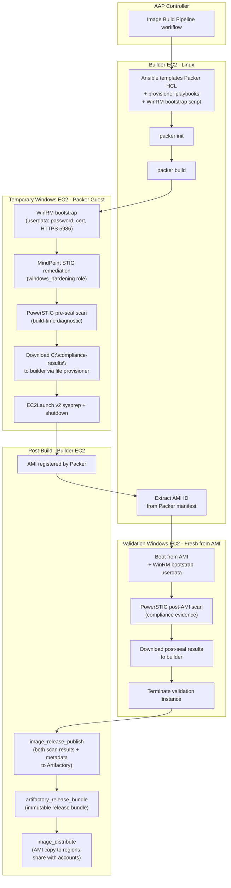

# Windows Server Image Pipeline -- Technical Approach

## Executive Summary

The image pipeline builds Windows Server 2022 golden AMIs on AWS from the vendor Marketplace base image. Each build
applies STIG remediation with the MindPoint Group Ansible role, then runs a PowerSTIG scan before the instance is
generalized with EC2Launch v2 Sysprep. Two STIG rules are deferred during the build so provisioning can complete
(ADR-025). The approach uses the OS-native FIPS 140-3 validated cryptographic modules (bcryptprimitives.dll and
CNG.sys); the specific CMVP certificates for the target build are to be verified in the runbook.

The pipeline will produce a STIG-compliance claim for the distributed AMI only after a post-seal scan against that AMI
is in place and its results are included in the release bundle (ADR-031). The pipeline shares builder, orchestration,
artifact, and distribution infrastructure with the RHEL pipeline. Windows-specific work is limited to the Packer
template, the hardening and scan roles, and the validation step. Open decisions include the source AMI pinning policy
and the scan pass/fail gate. FIPS certificate coverage targets FIPS 140-3 for the Windows Server 2022 build; FIPS 140-2
is out of scope by default, and customers who need it implement and own that variant through the pipeline's extension
points.

Key recommendations are recorded as Architecture Decision Records (ADRs). See the
[ADR Reference Table](#adr-reference-table) at the end of this document.

| Attribute            | Value                                                                     |
|----------------------|---------------------------------------------------------------------------|
| **Current delivery** | Windows Server 2022, AWS (`amazon-ebs`), base + poc profiles              |
| **Hardening**        | Ansible Lockdown `win2022stig` (DISA STIG)                                |
| **Compliance scan**  | PowerSTIG 4.30.0 (`WindowsServer-2022-MS`)                                |
| **Orchestration**    | AAP Controller workflow                                                   |
| **Artifacts**        | JFrog Artifactory Release Bundles (JSON/HTML scan results + AMI metadata) |

---

## Shared Infrastructure (RHEL Parity)

Everything below is already implemented for RHEL and reused by Windows with zero or minimal additional work. The
Windows pipeline does not rebuild this infrastructure; it inherits it. See
[RHEL-APPROACH.md § Shared Infrastructure](RHEL-APPROACH.md#shared-infrastructure) for the full descriptions of each
component, including inventory architecture, credential separation, and builder lifecycle details. This section
summarizes what Windows inherits and notes Windows-specific additions.

- **Builder EC2 lifecycle** (`builder_configure`, `start_builders`, `stop_builders`): the same managed EC2 hosts run
  both osbuild-composer (RHEL) and Packer (Windows). Packer is installed by `builder_configure` alongside
  osbuild-composer.
- **AAP workflow** (`Image Build Pipeline`): runs Build RHEL and Build Windows as parallel sibling nodes.
  Adding Windows was one workflow node and one job template.
- **Artifactory Release Bundles** (`artifactory_release_bundle`): same role for both RHEL (OpenSCAP XML/HTML) and
  Windows (PowerSTIG JSON/HTML).
- **AMI distribution** (`image_distribute`): cross-region copy and cross-account share. Same role and logic for
  RHEL-converted AMIs and Windows Packer AMIs.
- **AMI cleanup** (`ami_cleanup`): deregisters old AMIs by age/count policy. Shared.
- **Inventory architecture** (ADR-017): phantom hosts with four-dimension group-based variable merge and `delegate_to`
  real builders. Same pattern for both RHEL and Windows targets.
- **Secrets** (ADR-006): HashiCorp Vault. Windows adds one credential (`windows_winrm` for Packer WinRM authentication);
  everything else is shared.
- **IAM role separation** (ADR-029): per-function AWS credentials. Shared.

---

## Build Matrix

The inventory defines Windows build targets as phantom hosts across four dimensions. Each host belongs to multiple
groups; Ansible merges variables from all of them.

| Target              | OS Version     | Profile        | Build Method    |
|---------------------|----------------|----------------|-----------------|
| `windows-2022-base` | `windows_2022` | `profile_base` | `method_packer` |
| `windows-2022-poc`  | `windows_2022` | `profile_poc`  | `method_packer` |

Server 2025 support is not part of the current delivery but the pipeline is designed to accommodate it without
rearchitecting. See [Appendix B](#appendix-b-scaffolded-future-work-out-of-scope) for what would need to be created.

Per-profile customization (Windows features, registry entries) is applied before STIG hardening. The profile composition
system merges a base layer (`_base_windows_*`) with profile-specific overrides (`_profile_specific_windows_*`)
automatically. Adding a new profile requires only new group vars and an inventory entry -- no playbook or role changes.

Source: `inventory/targets.yml`, `inventory/group_vars/`.

---

## Source Images

The pipeline starts from the **Microsoft Windows Server 2022 Base** AMI (`Windows_Server-2022-English-Full-Base-*`), the
vanilla Full install (Desktop Experience) published by Amazon in the AWS Marketplace. This is the standard, unhardened
Windows Server edition with no bundled software (no SQL Server, no Containers) and no pre-applied security baselines.
"Base" means the GUI is present -- not Server Core -- which is required for manual validation during initial bring-up.

The pipeline does **not** use pre-hardened marketplace images (CIS Benchmark AMIs, third-party STIG-hardened AMIs, or
similar offerings). Pre-hardened images are rejected for the following reasons (ADR-026):

- **Hidden dependency risk.** Starting from a vanilla image ensures the pipeline explicitly owns every STIG control. If
  a pre-hardened image silently compensates for a gap in the pipeline's own remediation, that gap is invisible until the
  vendor changes their baseline or the pipeline switches source images -- at which point the system is out of compliance
  with no corresponding change in the pipeline's configuration.
- **Exception control.** STIG rule deferrals and exceptions are managed in code with documented justifications. A
  pre-hardened image applies an unknown set of rules with no per-rule toggles -- the pipeline cannot defer a rule the
  vendor already applied.
- **Reproducibility.** A vanilla base produces deterministic, repeatable builds. Pre-hardened images are opaque
  snapshots whose internal state may change between vendor releases without notice.
- **No double-hardening conflicts.** CIS Benchmarks and DISA STIGs are different baselines. Applying DISA STIG on top of
  a CIS-hardened image creates unpredictable interactions (conflicting registry values, audit policies, service states).

Rationale for marketplace sourcing over offline ISO/BYOL builds (ADR-002, ADR-014):

- Licensing is delegated to the marketplace publisher; no BYOL license management.
- OS patching is handled via marketplace AMI updates; no WSUS infrastructure needed at build time.
- FedRAMP marketplace compliance requirements are met by the publisher.
- No ISO storage, checksum management, or `autounattend.xml` complexity.

The `source_ami` is set per OS version in inventory group vars (`inventory/group_vars/windows_2022.yml`).

The same marketplace-sourcing strategy applies to future Azure and GCP targets (ADR-014) -- no architecture change will
be needed.

### Source AMI Discovery

Three approaches exist for resolving the correct Microsoft Windows Server base AMI at build time:

1. **Hardcoded AMI ID.** A specific AMI ID is set in inventory group vars (e.g., `windows_2022.yml`). Simple and fully
   reproducible, but AMI IDs are region-specific, require manual updates when Microsoft publishes new images, and become
   stale if the pipeline runs infrequently.
2. **Packer `source_ami_filter`.** The Packer HCL template uses a `source_ami_filter` block with `owners = ["amazon"]`,
   a name pattern like `Windows_Server-2022-English-Full-Base-*`, and `most_recent = true`. This is declarative, lives
   in the template, and auto-discovers the latest AMI at build time without a separate lookup step.
3. **AWS SSM Public Parameter.** AWS publishes the latest AMI ID at a well-known path
   (`/aws/service/ami-windows-latest/Windows_Server-2022-English-Full-Base`). Ansible can read the parameter before
   templating the Packer HCL, injecting the resolved AMI ID into the template.

**Recommendation:** `source_ami_filter` is the standard Packer pattern and the most self-contained option. The
inventory variables in `windows_2022.yml` should provide the filter parameters (`source_ami_name_pattern`,
`source_ami_owner`) rather than a hardcoded AMI ID. The Jinja2 template renders these into a `source_ami_filter` block
in the Packer HCL. If the team prefers pinned, reproducible builds over automatic freshness, a hardcoded `source_ami`
override remains available as an inventory variable that takes precedence over the filter.

The choice between pinned AMI (reproducibility) and dynamic filter (freshness) is a policy decision that should be
finalized before the first production build.

---

## Packer Build Process

Ansible templates the Packer HCL configuration and provisioner playbooks at build time using Jinja2. There are no static
`.pkr.hcl` files checked in; the templates are rendered per-target with values from inventory group vars.

Templates in `roles/windows_image_build/templates/`:

| Template                     | Rendered as              | Purpose                                                    |
|------------------------------|--------------------------|------------------------------------------------------------|
| `windows-ami.pkr.hcl.j2`     | `<vm_name>.pkr.hcl`      | Packer source + build block                                |
| `windows-ami.pkrvars.hcl.j2` | `<vm_name>.pkrvars.hcl`  | Variable values from inventory                             |
| `winrm-bootstrap.ps1.j2`     | `<vm_name>-userdata.ps1` | EC2 userdata: Administrator password, self-signed cert,    |
|                              |                          | HTTPS WinRM on 5986                                        |
| `windows-harden.yml.j2`      | `<vm_name>-harden.yml`   | Ansible provisioner: MindPoint STIG                        |
| `windows-scan.yml.j2`        | `<vm_name>-scan.yml`     | Ansible provisioner: PowerSTIG audit                       |
| `windows-sysprep.yml.j2`     | `<vm_name>-sysprep.yml`  | Ansible provisioner: EC2Launch v2 sysprep + shutdown       |

The Packer build block defines five provisioner steps that run in order inside the temporary Windows EC2 guest:

```
1. ansible provisioner  -> windows-harden.yml     (MindPoint STIG remediation)
2. ansible provisioner  -> windows-scan.yml       (PowerSTIG pre-seal scan)
3. file provisioner     -> C:\compliance-results\ downloaded to builder
4. ansible provisioner  -> windows-sysprep.yml    (EC2Launch v2 sysprep + shutdown)
5. post-processor       -> manifest JSON          (records AMI ID)
```

After Packer completes, the `windows_ami_validate` role runs a post-AMI compliance scan: it boots a fresh instance from
the registered AMI, runs PowerSTIG again, and downloads the authoritative scan results. See
[Post-AMI Compliance Validation](#post-ami-compliance-validation) for the full rationale and architecture.

After the EC2Launch v2 sysprep shuts down the instance, Packer registers the AMI and terminates the temporary EC2
instance. The `windows_image_build` role extracts the new AMI ID from the Packer manifest for use by downstream roles.

The pre-seal scan (step 2) is a build-time diagnostic; it catches hardening failures early but does not evaluate the
production artifact. The post-AMI scan is the authoritative compliance evidence for the shipped image.

Packer plugins: HashiCorp `amazon` `~> 1`, HashiCorp `ansible` `~> 1` (pessimistic constraint, per
[HashiCorp's recommended plugin versioning](https://developer.hashicorp.com/packer/docs/plugins/install) -- allows any
stable v1.x release while preventing unexpected major-version jumps).

The outer Ansible run (on the builder host) never connects to the Windows guest. It templates files and runs
`packer init && packer build`. Only Packer's internal Ansible provisioner communicates with the guest via WinRM.

### Image Generalization (Sysprep + EC2Launch v2)

AWS Marketplace Windows AMIs ship with
[EC2Launch v2](https://docs.aws.amazon.com/AWSEC2/latest/WindowsGuide/ec2launch-v2.html) pre-installed. The recommended
generalization path is `EC2Launch.exe sysprep --shutdown=true` (`C:\ProgramData\Amazon\EC2Launch\EC2Launch.exe`), which:

- Runs EC2Launch v2's own cleanup tasks: clears instance metadata, resets Administrator password handling (so the EC2
  console "Get Windows Password" flow works on first boot), prepares userdata for re-execution, and generates a new RDP
  self-signed certificate.
- Invokes `sysprep.exe /generalize /oobe /shutdown` internally after its cleanup is complete.

Calling raw `sysprep.exe` directly -- without going through EC2Launch v2 -- skips these AWS-specific cleanup hooks. The
resulting AMI may not re-initialize properly at first boot in EC2: the Administrator password may not be retrievable
via the console, userdata may not re-run, and the instance may keep stale metadata from the build instance. Using
`ec2launch.exe sysprep` is the
[AWS-documented path for AMI creation](https://docs.aws.amazon.com/AWSEC2/latest/WindowsGuide/ec2launch-v2-sysprep.html)
from Windows instances and avoids these issues.

The sysprep provisioner playbook (`windows-sysprep.yml.j2`) invokes EC2Launch v2 as its final action. After EC2Launch v2
runs Sysprep and the instance shuts down, Packer snapshots the stopped instance into an AMI.

---

## Connection Protocol and FIPS

**Build-time: WinRM over HTTPS.** Packer connects to the temporary Windows EC2 guest using WinRM with a self-signed
certificate on port 5986. This is the only viable protocol during image creation, before any domain/PKI infrastructure
exists. The WinRM bootstrap userdata script (`roles/windows_image_build/templates/winrm-bootstrap.ps1.j2`) sets the
Administrator password, creates the self-signed certificate, configures the HTTPS listener, disables unencrypted
transport, and opens the firewall.

**Day-2 (AAP): PSRP over HTTPS.** For production management after deployment, PSRP (PowerShell Remoting Protocol) over
HTTPS is the preferred Ansible connection plugin. PSRP provides better performance and richer error handling than WinRM
Basic auth. Day-2 PSRP requires `pypsrp` in the Ansible Execution Environment; the EE is owned by the AAP/platform
team, not the image pipeline team. This dependency should be communicated when day-2 Windows management is brought
online.

**OpenSSH rejected as Ansible transport.** LibreSSL on Windows is not FIPS-validated, making SSH unsuitable as the
Ansible connection protocol under FIPS 140-3 requirements.

**FIPS 140-3:** the MindPoint STIG role sets the `FIPSAlgorithmPolicy\Enabled` registry flag as part of the DISA STIG
baseline during the Packer build. This pipeline does not set the flag independently; it relies on MindPoint's STIG
coverage for the applicable rule. The post-AMI validation step confirms the flag persisted through Sysprep and is
active on the booted instance.

Architecture detail: the outer Ansible run (on the Linux builder host) uses SSH to talk to the builder. It never touches
WinRM. Only Packer's internal Ansible provisioner uses WinRM to the Windows guest. This is a deliberate two-hop design
(ADR-021).

### WinRM Is Not Deprecated

A persistent misconception in the automation community is that WinRM is deprecated or will be replaced by OpenSSH.
**This is not true.** Neither Microsoft nor Red Hat has deprecated WinRM or the Ansible WinRM/PSRP connection plugins.
The decision to use WinRM/PSRP for this pipeline is not swimming against a deprecation current -- it is using the
platform's recommended management protocol.

**Microsoft's position: WinRM is supported and ships with all current Windows versions.**

- WinRM is "automatically installed with all currently-supported versions of the Windows operating system"
  ([Microsoft Learn: WinRM Installation and Configuration](https://learn.microsoft.com/en-us/windows/win32/winrm/installation-and-configuration-for-windows-remote-management)).
- PowerShell Remoting, which uses WinRM as its transport, is described as "the recommended way to manage Windows
  systems" ([PowerShell Docs: WinRM Security](https://github.com/MicrosoftDocs/PowerShell-Docs/blob/main/reference/docs-conceptual/security/remoting/WinRM-Security.md)).
- The only WinRM-related deprecation in Microsoft's
  [Windows Server removed/deprecated features list](https://learn.microsoft.com/en-us/windows-server/get-started/removed-deprecated-features-windows-server)
  is `WinRM.vbs` (the VBScript helper script), not the WinRM service or protocol. The recommendation is to use the
  PowerShell WinRM provider instead of the VBScript wrapper.
- SSH-based PowerShell Remoting is positioned as a cross-platform alternative, not a replacement. Microsoft's own docs
  note that SSH remoting "doesn't currently support remote endpoint configuration and Just Enough Administration (JEA)"
  ([PowerShell Docs: SSH Remoting](https://learn.microsoft.com/en-us/powershell/scripting/security/remoting/ssh-remoting-in-powershell)).
  WinRM retains capabilities that SSH does not offer.

**Red Hat / Ansible's position: The `ansible.builtin.winrm` plugin is not deprecated.**

- The Ansible
  [deprecated plugins index](https://docs.ansible.com/projects/ansible/13/collections/deprecations.html)
  lists `ansible.builtin.paramiko_ssh` as the only deprecated connection plugin. `ansible.builtin.winrm` is not on the
  list.
- Red Hat AAP 2.6 documentation describes `ansible.builtin.winrm` as "still fully functional" and says it is "often
  superseded by PSRP for new deployments"
  ([AAP 2.6: Connect Securely to Windows Hosts](https://docs.redhat.com/en/documentation/red_hat_ansible_automation_platform/2.6/configure-connect_securely_to_windows_hosts)).
  PSRP is recommended for performance (persistent Runspace Pools, ~20-25% faster task execution), not because WinRM is
  being removed.
- The AAP 2.6 "Connect securely to Windows hosts" guide uses the phrase "Deprecate Legacy WinRM" as an action-item
  heading, advising users to move to PSRP. This is user guidance ("we recommend PSRP for new deployments"), not a
  formal product deprecation notice. The plugin remains in `ansible-core` with no removal timeline.

**Where the perception comes from:**

- Red Hat's use of "Deprecate" as a verb in their guidance doc, recommending users move to PSRP for performance.
- **OpenTofu (Terraform fork) IS formally deprecating WinRM** in their provisioners
  ([opentofu/opentofu#3406](https://github.com/opentofu/opentofu/issues/3406)): deprecation warning in v1.12, error in
  v1.13, full removal in v1.14. This is a tooling decision specific to OpenTofu and does not reflect the status of WinRM
  as a Windows platform component.
- Microsoft's investment in OpenSSH for Windows (installed by default in Server 2025), which signals strategic direction
  but is not accompanied by any WinRM deprecation notice.
- General industry sentiment that SSH is "modern" and WinRM is "legacy."

**Why this matters for the pipeline:** The decision to use PSRP (day-2) and WinRM (build-time) is correct on technical
merits -- SChannel TLS is FIPS-validated, LibreSSL is not -- and is not at risk of being undermined by a deprecation.
If Microsoft ever does deprecate WinRM, the revisit triggers in ADR-021 already cover that scenario.

| # | Claim                               | Source                              | URL                                  |
|---|-------------------------------------|-------------------------------------|--------------------------------------|
| 1 | WinRM ships with all supported      | Microsoft Learn: WinRM Installation | https://learn.microsoft.com/en-us/windows/win32/winrm/installation-and-configuration-for-windows-remote-management |
|   | Windows versions                    |                                     |                                      |
| 2 | PowerShell Remoting (WinRM) is "the | PowerShell Docs: WinRM Security     | https://github.com/MicrosoftDocs/PowerShell-Docs/blob/main/reference/docs-conceptual/security/remoting/WinRM-Security.md |
|   | recommended way to manage Windows   |                                     |                                      |
|   | systems"                            |                                     |                                      |
| 3 | Only `WinRM.vbs` is deprecated, not | Microsoft Learn: Windows Server     | https://learn.microsoft.com/en-us/windows-server/get-started/removed-deprecated-features-windows-server |
|   | WinRM itself                        | removed/deprecated features         |                                      |
| 4 | SSH remoting does not support JEA   | PowerShell Docs: SSH Remoting in    | https://learn.microsoft.com/en-us/powershell/scripting/security/remoting/ssh-remoting-in-powershell |
|   | or endpoint configuration           | PowerShell                          |                                      |
| 5 | `ansible.builtin.winrm` is not on   | Ansible deprecated plugins index    | https://docs.ansible.com/projects/ansible/13/collections/deprecations.html |
|   | the deprecated plugins list         |                                     |                                      |
| 6 | Red Hat calls WinRM "still fully    | Red Hat AAP 2.6: Connect securely   | https://docs.redhat.com/en/documentation/red_hat_ansible_automation_platform/2.6/configure-connect_securely_to_windows_hosts |
|   | functional"; recommends PSRP for    | to Windows hosts                    |                                      |
|   | performance                         |                                     |                                      |
| 7 | OpenTofu is deprecating WinRM in    | opentofu/opentofu#3406              | https://github.com/opentofu/opentofu/issues/3406 |
|   | their provisioners (tooling         |                                     |                                      |
|   | decision)                           |                                     |                                      |

---

## FIPS 140-3 Enablement: Why Windows and RHEL Differ

RHEL and Windows take fundamentally different approaches to FIPS 140-3 enablement. On RHEL, FIPS mode **must** be
enabled at install time (before first boot). On Windows, FIPS mode is enabled post-boot via a registry key and reboot,
and the system is still FIPS-compliant. This section explains **why** the difference exists, **what makes it
architecturally sound**, and **what to say when an auditor asks about it**.

### RHEL: Pluggable Crypto Architecture and the Tainted Key Problem

Linux has a **pluggable cryptographic architecture** with multiple independent libraries, each with its own codebase,
its own FIPS validation, and its own key generation behavior:

| Library                 | Role                                                  | FIPS Module                                  |
|-------------------------|-------------------------------------------------------|----------------------------------------------|
| OpenSSL 3.x             | User-mode TLS, key generation, certificate operations | `fips.so` provider (CMVP #4746 for RHEL 9) |
| GnuTLS                  | Alternative TLS (used by some system services)        | Separate FIPS validation                     |
| libgcrypt               | GnuPG, disk encryption operations                     | Separate FIPS validation                     |
| NSS                     | Firefox, Network Security Services                    | Separate FIPS validation                     |
| Kernel crypto subsystem | dm-crypt/LUKS, IPsec, kernel TLS                      | Built-in kernel FIPS module                  |

When RHEL boots **without** `fips=1` on the kernel command line:

1. **SSH host keys** are generated by OpenSSH using whatever OpenSSL provider is active. Without FIPS mode, the
   `default` provider is loaded instead of `fips.so`. Keys may be generated with non-FIPS algorithms (e.g., Ed25519,
   which is not FIPS-approved).
2. **LUKS disk encryption** uses `cryptsetup` with Argon2 as the default key derivation function. Argon2 is not
   FIPS-approved. In FIPS mode, `cryptsetup` uses PBKDF2 instead. A LUKS volume created with Argon2 as the only keyslot
   **cannot be decrypted in FIPS mode** -- the system may become unbootable.
3. **IdM/FreeIPA realm keys** are generated at realm initialization. These keys cannot be retroactively regenerated
   without rebuilding the entire realm.
4. **The kernel crypto subsystem** does not run its self-tests. `/proc/sys/crypto/fips_enabled` reads `0`, and
   kernel-level crypto consumers do not restrict themselves to FIPS-approved algorithms.

These keys are **generated once and persist**. They cannot be retroactively made compliant.

Red Hat's official documentation states this explicitly:

> *"Only enabling FIPS mode during the RHEL installation ensures that the system generates all keys with FIPS-approved
> algorithms and continuous monitoring tests in place."*
>
> -- [RHEL 9 Security Hardening Guide, Chapter 3](https://docs.redhat.com/en/documentation/red_hat_enterprise_linux/9/html/security_hardening/switching-rhel-to-fips-mode_security-hardening)

And the stronger warning:

> *"Switching the system to FIPS mode by using the `fips-mode-setup` tool does not guarantee compliance with the FIPS
> 140 standard. Re-generating all cryptographic keys after setting the system to FIPS mode may not be possible."*
>
> -- Same source

The Fedora crypto-policies team (upstream of RHEL) went further in their rationale for deprecating `fips-mode-setup`:

> *"Several components may have already made decisions based on FIPS mode at that point. For example, cryptsetup
> defaults to Argon2 as key-derivation function and uses PBKDF2 in FIPS mode. Installing a system with LUKS disk
> encryption and switching it to FIPS mode could thus render it unbootable."*
>
> -- [Fedora crypto-policies MR !205](https://gitlab.com/redhat-crypto/fedora-crypto-policies/-/merge_requests/205)

**This is why our RHEL pipeline enables FIPS at osbuild-composer compose time** -- the blueprint sets
`[customizations.fips] enabled = true` and appends `fips=1` to the kernel command line, so every key generated from the
very first boot is FIPS-compliant. There is no window where non-FIPS keys can be created.

### Windows: Centralized Crypto Architecture and Runtime Policy

Windows has a **centralized cryptographic architecture** called CNG (Cryptography: Next Generation). Unlike Linux's
pluggable library ecosystem, virtually all cryptographic operations on Windows go through exactly two validated modules:

| Module                 | Mode        | CMVP Certificate (Server 2022)         |
|------------------------|-------------|----------------------------------------|
| `bcryptprimitives.dll` | User-mode   | #5410 (FIPS 140-3, active)           |
| `CNG.sys`              | Kernel-mode | #5408 (FIPS 140-3, active)           |

Note: earlier FIPS 140-2 validations for these modules (#4825 and #4766 respectively) covered the base Server 2022
build (10.0.20348) but have been moved to the CMVP Historical list due to sunsetting. The FIPS 140-3 validations
(#5410 and #5408, validated August 2026) cover build 10.0.20348.1668 and later. The AWS Marketplace AMI must be at
or above this build number to be covered by the active 140-3 validation; this is a Phase 0 verification item.

Applications call `bcrypt.dll` (an API wrapper) which routes to `bcryptprimitives.dll`. Kernel-mode callers go through
`ksecdd.sys` which routes to `CNG.sys`. SChannel (TLS), RDP, BitLocker, EFS, DPAPI, and the vast majority of Windows
services all use this single crypto stack.

**The critical architectural difference: FIPS mode is a runtime gate, not a module swap.** When FIPS mode is off, the
**same validated modules** (`bcryptprimitives.dll`, `CNG.sys`) perform all cryptographic operations. They just also
*allow* non-approved algorithms (RC4, MD5, SHA-1 for new signatures) if a caller explicitly requests them. When FIPS
mode is turned on:

1. The modules run their FIPS self-tests at boot
2. CNG rejects requests for non-approved algorithms (callers get `STATUS_NOT_SUPPORTED`)
3. SChannel restricts TLS negotiation to FIPS-approved cipher suites

But the **underlying cryptographic module is the same binary, performing the same operations, using the same algorithms
for all standard operations, whether FIPS mode is on or off.** AES, RSA, ECDSA, SHA-2, and ECDH are CNG defaults
regardless of the FIPS flag. Keys generated by CNG before FIPS mode was enabled were still generated by the
CMVP-validated module using FIPS-approved algorithms (assuming the caller did not explicitly request a non-approved
algorithm, which standard Windows services do not).

The CMVP Security Policy document for `bcryptprimitives.dll` explicitly describes registry-based enablement as the
approved operational procedure:

> *"Cryptographic Primitives Library operates in its FIPS mode of operation by setting any one of the following DWORD
> registry values to 1:*
> - *`\HKLM\System\CurrentControlSet\Control\Lsa\FIPSAlgorithmPolicy\Enabled`*
> - *`\HKLM\System\CurrentControlSet\Control\Lsa\FIPSAlgorithmPolicy`*
> - *`\HKLM\System\CurrentControlSet\Control\Lsa\FIPSAlgorithmPolicy\MDMEnabled`*
>
> *Changes to the FIPS mode registry setting do not take effect until the Windows OS has been rebooted."*
>
> -- NIST CMVP Security Policy for bcryptprimitives.dll (see Citable Sources row 4 below for version-specific links)

There is **no** "must be enabled at install time" caveat anywhere in the Microsoft CMVP Security Policy documents. The
Security Policy describes a post-boot configuration change (set registry key, reboot) as the standard procedure for
entering the FIPS-approved mode of operation.

Microsoft's own documentation reinforces this:

> *"In current versions of Windows, when you enable the FIPS mode setting, the Cryptographic Primitives Library
> (bcryptprimitives.dll) and Kernel Mode Cryptographic Primitives Library (CNG.sys) modules will run self-tests before
> Windows runs cryptographic operations. These self-tests meet FIPS 140 requirements and ensure that the modules are
> functioning properly. The Cryptographic Primitives Library and the Kernel Mode Cryptographic Primitives Library are
> the only modules that use the FIPS mode configuration setting. **FIPS mode does not control which cryptographic
> algorithms are used.** The FIPS mode setting is intended for use only by the Cryptographic Primitives Library
> (bcryptprimitives.dll) and Kernel Mode Cryptographic Primitives Library (CNG.sys) components in Windows."*
>
> -- [Microsoft Learn: Windows FIPS 140 validation](https://learn.microsoft.com/en-us/windows/security/security-foundations/certification/fips-140-validation)

Note the bolded sentence: "FIPS mode does not control which cryptographic algorithms are used." This is the opposite of
Linux, where FIPS mode fundamentally changes which libraries and algorithms are active. On Windows, the algorithms are
the same; FIPS mode adds self-tests and makes the modules refuse explicitly non-approved requests.

### How This Applies to Our Pipeline

In our image build pipeline:

- **RHEL:** FIPS is enabled at compose time via the osbuild-composer blueprint (`[customizations.fips]` + `fips=1`
  kernel append). The RHEL image has never booted without FIPS. Every key generated from the first boot cycle is
  FIPS-compliant. There is no tainted key window.

- **Windows:** The Packer guest boots from a marketplace AMI without FIPS mode. The MindPoint STIG hardening role
  enables FIPS mode via registry settings during the build. Sysprep generalizes the image. When the AMI is deployed and
  boots for the first time in production, it boots **with FIPS mode already enabled** (the registry setting persists
  through Sysprep). The production instance has never run without FIPS in a production context. The build-time window
  without FIPS is irrelevant because: (a) the build instance is ephemeral and never serves production traffic, (b) no
  persistent keys are generated during the build that survive into the distributed AMI (Sysprep strips machine-specific
  state), and (c) the cryptographic operations during the build were performed by the same validated CNG modules that
  will run in FIPS mode after deployment.

### The Argument for an Auditor

If an auditor asks: *"You enable FIPS at install time for RHEL but post-boot for Windows. Why the inconsistency?"*

The response:

> The difference is architectural, not procedural. Linux has a pluggable cryptographic stack with multiple independent
> libraries (OpenSSL, GnuTLS, libgcrypt, kernel crypto). FIPS mode must be enabled at install time because
> key-generating services (SSH, LUKS, IdM) run at first boot across these libraries, and keys generated without FIPS
> mode may use non-approved algorithms on non-validated modules. Those keys persist and cannot be retroactively
> regenerated -- Red Hat's own documentation states this explicitly.
>
> Windows has a centralized cryptographic stack (CNG) where all cryptographic operations go through the same
> CMVP-validated modules (`bcryptprimitives.dll`, `CNG.sys`) whether FIPS mode is on or off. The FIPS mode registry
> setting is a runtime policy flag that triggers self-tests and restricts algorithm availability; it is not a module
> swap. The CMVP Security Policy documents for these modules explicitly describe enabling FIPS via registry key and
> reboot as the approved operational procedure, with no install-time requirement. There is no "tainted keys" risk on
> Windows because the same validated module was performing the cryptographic operations all along.
>
> In our pipeline, the distributed Windows AMI boots into production with FIPS mode already enabled (the registry
> setting persists through Sysprep). The production instance has never run without FIPS in a production context. The
> ephemeral build window is analogous to RHEL's osbuild-composer compose process -- it is a controlled build
> environment, not a production runtime.

### Citable Sources

| # | Claim                                         | Source                                                   | URL      |
|---|-----------------------------------------------|----------------------------------------------------------|----------|
| 1 | RHEL: FIPS must be enabled at install time    | Red Hat, RHEL 9 Security Hardening Guide, Ch. 3          | https://docs.redhat.com/en/documentation/red_hat_enterprise_linux/9/html/security_hardening/switching-rhel-to-fips-mode_security-hardening |
| 2 | RHEL: Keys may not be re-generatable after    | Same source: "Re-generating all cryptographic keys after | Same URL |
|   | FIPS is enabled late                          | setting the system to FIPS mode may not be possible"     |          |
| 3 | RHEL: LUKS Argon2 can make systems unbootable | Fedora crypto-policies MR !205 (upstream of RHEL)        | https://gitlab.com/redhat-crypto/fedora-crypto-policies/-/merge_requests/205 |
| 4 | Windows: FIPS enabled via registry            | CMVP Security Policy for bcryptprimitives.dll            | https://csrc.nist.gov/projects/cryptographic-module-validation-program/certificate/5410 |
|   | + reboot (approved procedure)                 | (cert #5410)                                           |          |
| 5 | Windows: Same CNG module with or without FIPS | Microsoft Learn: "FIPS mode does not control which       | https://learn.microsoft.com/en-us/windows/security/security-foundations/certification/fips-140-validation |
|   |                                               | cryptographic algorithms are used"                       |          |
| 6 | Windows: CMVP certificates for Server 2022    | FIPS 140-3: #5410 (bcryptprimitives.dll),              | https://learn.microsoft.com/en-us/windows/security/security-foundations/certification/validations/fips-140-windows-server-2022 |
|   | (active, build 10.0.20348.1668)               | #5408 (CNG.sys). Validated Aug 2026.                   |          |
| 7 | Windows: CNG.sys CMVP cert (kernel-mode)      | CMVP cert #5408 (FIPS 140-3, active, sunset 8/30/2031) | https://csrc.nist.gov/projects/cryptographic-module-validation-program/certificate/5408 |
| 8 | Windows: bcryptprimitives.dll CMVP cert       | CMVP cert #5410 (FIPS 140-3, active, sunset 8/30/2031) | https://csrc.nist.gov/projects/cryptographic-module-validation-program/certificate/5410 |
|   | (user-mode)                                   |                                                          |          |

---

## STIG Hardening (MindPoint Group)

The `windows_hardening` role (`roles/windows_hardening/`) applies DISA STIG remediation using the MindPoint Group
Ansible collection. It runs as a Packer Ansible provisioner inside the Windows guest.

The role's tasks execute in order:

1. **Profile features** -- install any Windows features required by the profile (e.g., `.NET Framework` for poc profile)
   via `ansible.windows.win_feature`.
2. **Profile registry** -- apply profile-specific registry entries via `ansible.windows.win_regedit`.
3. **Ansible Lockdown STIG** -- `include_role: win2022stig` applies the full DISA STIG baseline.

The role name is set by the `windows_stig_role` inventory variable (default: `win2022stig`), making the provider
swappable without code changes.

**Per-rule toggles:** MindPoint exposes each STIG rule as a variable named `win2022stig_rule_XXXXXX_enabled` (default:
`true`). Setting any of these to `false` in inventory group vars disables that rule. No overrides are active yet -- the
current builds apply a clean STIG baseline.

**Collection installation:** MindPoint is installed at AAP project sync time, not baked into an Execution Environment.
This keeps EE images lean and allows the collection version to be updated without rebuilding an EE.

**Selection rationale (ADR-022):** MindPoint was chosen over:

- Ansible Lockdown -- narrower STIG rule coverage for Windows.
- Manual PowerShell/DSC scripts -- unscalable, no idempotency guarantees.
- DISA Group Policy Objects -- not automatable via Ansible, domain-dependent.

---

## Build-Time Authentication Continuity (ADR-025)

Two STIG rules, if applied during the hardening provisioner, break the Packer provisioner chain by severing the WinRM
connection that subsequent provisioners (compliance scan, file download, sysprep) depend on:

- **V-254381** -- WinRM service must not use Basic authentication. The Packer WinRM communicator uses Basic auth with
  the bootstrap password. Applying this rule disables Basic auth, killing connectivity for all remaining provisioners.
- **V-254447** -- The built-in Administrator account must be renamed. Packer authenticates as `Administrator`. Renaming
  the account mid-build invalidates the credential.

Both controls are legitimate STIG requirements that **must** be present in the finished AMI. The problem is timing, not
correctness.

### The Approach

1. **Defer during hardening.** MindPoint Group exposes per-rule toggle variables. The two rules are disabled in
   inventory group vars so the STIG role skips them:
   - `wn22_cc_000500: false` (disables V-254381, WinRM Basic auth restriction)
   - `wn22_so_000030: false` (disables V-254447, Administrator rename)

2. **Provisioners 2-4 run with connectivity intact.** PowerSTIG scans the instance, the file provisioner downloads
   compliance results to the builder, and the sysprep provisioner connects -- all over WinRM Basic auth to
   `Administrator`.

3. **Re-apply before snapshot.** The sysprep provisioner playbook (`windows-sysprep.yml.j2`), as its final steps before
   invoking EC2Launch v2 sysprep, re-applies the two deferred controls:
   - Disable WinRM Basic auth via registry (`HKLM:\SOFTWARE\Policies\Microsoft\Windows\WinRM\Service\AllowBasic` set to
     `0`).
   - Rename the built-in Administrator account.
   - At this point WinRM is severed, but no further provisioners need it -- EC2Launch v2 sysprep shuts down the instance
     and Packer snapshots the result.

4. **Expected pre-seal findings; verified by post-AMI scan.** The pre-seal PowerSTIG scan runs before re-application
   (provisioner 2), so its results will show V-254381 and V-254447 as findings. These are annotated in the pre-seal
   scan results as "deferred per ADR-025; applied in sysprep provisioner before snapshot." The post-AMI validation scan
   (ADR-031) independently verifies that both rules are in their STIG-required state in the shipped AMI.

The hardened AMI, when deployed, has both controls in place. The deferral window exists only during the ephemeral build
instance, which never serves production traffic.

---

## Compliance Scanning (PowerSTIG)

### Pre-Seal Scan (Build-Time Diagnostic)

The `windows_compliance_scan` role (`roles/windows_compliance_scan/`) runs a post-hardening STIG audit using PowerSTIG.
It runs inside the Packer guest after MindPoint remediation and before Sysprep. This is the **pre-seal scan**: a
build-time diagnostic that catches hardening failures early, before the slower Sysprep and AMI creation steps.

**Independent verification:** PowerSTIG is a different tool from the remediator (MindPoint). This is deliberate; the
auditor does not grade its own homework (ADR-023).

The pre-seal scan process:

1. Install PowerSTIG 4.30.0 from the PowerShell Gallery.
2. Run `Get-StigChecklist` with `StigId: WindowsServer-2022-MS`.
3. Export `pre-seal-stig-results.json` (structured: per-rule pass/fail/N/A/not-reviewed with counts).
4. Generate `pre-seal-stig-report.html` (color-coded summary table).
5. Packer file provisioner downloads `C:\compliance-results\` to the builder host.

The JSON results include per-rule detail:

```json
{
  "stig_id": "WindowsServer-2022-MS",
  "scan_timestamp": "2026-10-07T16:30:00Z",
  "hostname": "EC2AMAZ-XXXXXX",
  "total_rules": 285,
  "passed": 270,
  "failed": 8,
  "not_applicable": 5,
  "not_reviewed": 2,
  "rules": [
    { "rule_id": "V-254239", "status": "Pass", "title": "..." },
    ...
  ]
}
```

**Selection rationale (ADR-023):** PowerSTIG was chosen over:

- OpenSCAP for Windows -- poor Windows STIG content coverage.
- STIG Viewer -- manual, not scriptable.
- ACAS/Nessus -- runtime-only scanning, not available at build time.

---

## Post-AMI Compliance Validation

The pre-seal PowerSTIG scan (provisioner 2) runs inside the Packer guest after hardening but before Sysprep. It is a
useful build-time diagnostic, but it does not evaluate the production artifact. Between the scan and the AMI snapshot,
three things change the system state:

1. The two deferred STIG rules (V-254381, V-254447) are applied in the sysprep provisioner, after the scan.
2. Sysprep generalizes the instance: EC2Launch v2 clears machine identity, resets password handling, regenerates the RDP
   certificate, and modifies registry entries.
3. On first boot from the AMI, EC2Launch v2 runs first-boot tasks that further modify system state.

The pre-seal scan records V-254381 and V-254447 as findings and annotates them as "deferred per ADR-025; applied in
sysprep provisioner before snapshot." But that annotation is a claim, not evidence. Nobody verifies whether the
re-application actually succeeded, and nobody checks whether Sysprep undid any other STIG control.

The manual runbook (Phase 0, step 7) already includes this validation: "Boot a new instance from that AMI. Confirm FIPS
mode is enabled, WinRM Basic auth is disabled, Administrator is renamed, and the system functions normally." The
automated pipeline must be at least as rigorous as the manual process it replaces.

### The Post-AMI Validation Step

After the Packer build completes and the AMI is registered, the `windows_ami_validate` role:

1. **Launches a fresh EC2 instance** from the newly created AMI, with userdata that re-bootstraps WinRM HTTPS
   connectivity (new Administrator password, new self-signed certificate, HTTPS listener on 5986).
2. **Waits for WinRM** to become available on the validation instance.
3. **Runs PowerSTIG** against the live instance, producing a second set of scan results (`post-seal-stig-results.json`,
   `post-seal-stig-report.html`).
4. **Downloads results** to the builder host.
5. **Terminates the validation instance** and cleans up the temporary security group and key pair.

The post-AMI scan results are the authoritative compliance evidence for the shipped image. They go into the Artifactory
release bundle alongside the pre-seal results. Auditors see evidence from the actual artifact, not from a precursor
state.

### Why the Pre-Seal Scan Is Kept

The pre-seal scan serves a different purpose than the post-AMI scan and is worth keeping:

- **Fast feedback.** If MindPoint hardening fails to apply a control, the pre-seal scan catches it immediately, before
  the slower Sysprep and AMI creation steps. Waiting for the post-AMI scan to discover a hardening failure wastes 20-30
  minutes of Sysprep, snapshot, instance launch, and re-scan time.
- **Hardening regression detection.** When updating the MindPoint collection version or adding new STIG rule overrides,
  the pre-seal scan shows the immediate effect of the change. The post-AMI scan confirms the change survived
  generalization.
- **Build diagnostics.** The pre-seal results, combined with the post-AMI results, create a before/after view of the
  Sysprep transition. If a rule passes pre-seal but fails post-AMI, the failure is attributable to Sysprep or
  first-boot re-initialization, not to the hardening step.

The two scans form a complementary pair: the pre-seal scan validates the hardening; the post-AMI scan validates the
artifact.

---

## Why Two Scans for Windows but One for RHEL

The Windows pipeline runs two PowerSTIG scans (pre-seal and post-AMI) and packages both in the release bundle. The RHEL
pipeline runs a single `oscap-chroot` scan and packages that. This is not an inconsistency; it reflects a fundamental
architectural difference between how the two platforms produce images.

### RHEL: The Scan Target IS the Artifact

RHEL images are built by osbuild-composer. The compose produces a qcow2 file directly on the builder host, with FIPS
and STIG baked in at compose time via the blueprint's `[customizations.openscap]` section. The resulting qcow2 is the
golden artifact.

After the compose, `oscap-chroot` scans the qcow2 by mounting it read-only via `guestmount` and running OpenSCAP
against the mounted filesystem. The scan target is the actual qcow2 that will be converted to an AMI/VHD/GCP image.
Cloud conversion (`qcow2 -> raw -> AMI`) is a format transformation: the same bits are repackaged into a different
container, but the filesystem contents, registry, and configuration are identical. The `oscap-chroot` scan evaluates
the artifact that ships.

There is no Sysprep-equivalent step for RHEL. There is no generalization pass that modifies registry entries, resets
identity, or runs cleanup hooks. There is no deferred-rule re-application step. The qcow2 after the compose is the same
qcow2 after the scan, and the same bits inside the AMI. One scan is sufficient because the scan target and the shipped
artifact are the same object.

(The RHEL offline scan does have a known limitation: rules that require a running system, such as process checks,
service state, and network configuration, report "not applicable" in offline mode. These rules ARE applied by Image
Builder during the compose; they just cannot be verified offline. Full runtime verification of RHEL images requires
booting a test instance, which is outside the current pipeline scope. This is a coverage gap, not a scan-target gap;
the scan is still evaluating the correct artifact.)

### Windows: The Scan Target Is NOT the Artifact

Windows images are built by Packer with an Ansible provisioner. The process requires a running Windows EC2 instance:
STIG hardening runs as Ansible tasks over WinRM, modifying registry entries, group policies, Windows features, and
service configurations in the live guest.

The pre-seal PowerSTIG scan runs inside this live guest after hardening. But the guest is not the production artifact.
After the scan:

1. **Two deferred STIG rules** (V-254381, V-254447) are applied in the sysprep provisioner. The pre-seal scan
   explicitly records these as findings.
2. **EC2Launch v2 + Sysprep** generalizes the instance: clears machine identity, resets Administrator password
   handling, regenerates the RDP certificate, and invokes `sysprep.exe /generalize /oobe /shutdown`. These operations
   modify registry entries and system state in ways that could revert STIG controls.
3. **Packer snapshots** the stopped, generalized instance into an AMI.
4. **First boot** from the AMI runs EC2Launch v2 first-boot tasks, which further modify system state.

The pre-seal scan evaluates a system state that no longer exists once the AMI is created. The AMI contains the
post-Sysprep, post-deferred-rule-reapplication state, which has never been independently scanned.

The post-AMI validation scan closes this gap by booting a fresh instance from the registered AMI and running PowerSTIG
against the production artifact. The result is authoritative compliance evidence for what actually ships.

### Summary

| Attribute                                | RHEL (`oscap-chroot`)             | Windows (pre-seal PowerSTIG)                | Windows (post-AMI PowerSTIG)       |
|------------------------------------------|-----------------------------------|---------------------------------------------|------------------------------------|
| Scan target                              | Mounted qcow2 filesystem          | Live Packer guest, pre-Sysprep              | Fresh instance from registered AMI |
| Is the scan target the shipped artifact? | Yes; cloud conversion is a format | No; Sysprep, deferred rules, and first-boot | Yes; this IS the artifact          |
|                                          | change, not a state change        | all modify state after the scan             |                                    |
| Deferred rules evaluated?                | N/A (no deferred rules in RHEL)   | No; V-254381 and V-254447 are recorded as   | Yes; both rules are in their final |
|                                          |                                   | findings                                    | state                              |
| Catches Sysprep regressions?             | N/A (no Sysprep in RHEL)          | No; runs before Sysprep                     | Yes                                |
| Purpose                                  | Compliance evidence for the       | Build-time diagnostic; fast                 | Compliance evidence for the        |
|                                          | shipped artifact                  | feedback on hardening                       | shipped artifact                   |
| Included in release bundle?              | Yes (sole scan)                   | Yes (labeled as pre-seal diagnostic)        | Yes (labeled as compliance record) |

RHEL needs one scan because the scan target is the artifact. Windows needs two because the scan target (live Packer
guest) and the artifact (AMI) are different objects in different states.

### Connection to the FIPS Difference

This is the same architectural divide that drives the FIPS handling difference described in
[FIPS 140-3 Enablement: Why Windows and RHEL Differ](#fips-140-3-enablement-why-windows-and-rhel-differ). Both
decisions stem from the same root question: **is the state verified at build time the same state that runs in
production?**

For FIPS: RHEL must enable FIPS at compose time because cryptographic keys generated at first boot persist and cannot
be retroactively made compliant. The compose-time state IS the first-boot state. Windows enables FIPS via a registry
key that persists through Sysprep; the same validated CNG modules perform cryptography regardless of the flag, so
post-boot enablement is architecturally sound.

For compliance scanning: RHEL's `oscap-chroot` scan evaluates the qcow2, which IS the artifact that ships (cloud
conversion is a format change). Windows' pre-seal scan evaluates a live guest that will be transformed by Sysprep
before it becomes the artifact. The verified state and the shipped state diverge.

In both cases, RHEL's build process produces an artifact whose verified state is its production state. Windows' build 
process includes a transformation step (Sysprep) between verification and the final artifact. The post-AMI scan exists 
because of that transformation; the FIPS-at-compose-time requirement exists because of an analogous transformation 
(first-boot key generation).

### RHEL: Future Post-Build Scan Option

The RHEL pipeline does not currently include a post-AMI runtime scan, and does not need one for the same reason Windows
does: there is no Sysprep-equivalent transformation between the scan target and the shipped artifact. However, the
offline `oscap-chroot` scan has a known coverage gap for rules that require a running system (process checks, service
state, network configuration). If the team later wants runtime verification of RHEL images, a post-AMI scan can be
added using the same pattern as the Windows `windows_ami_validate` role: boot an instance from the converted AMI, run
`oscap` against the live system, and include the results in the release bundle. This is a coverage improvement, not a
correctness requirement; the offline scan already evaluates the correct artifact.

### Revisit Trigger

The post-AMI scan is mandatory for the Windows pipeline. Revisit this decision if:

- **Sysprep behavior changes.** If a future Windows Server release or EC2Launch version changes what Sysprep modifies
  (e.g., stops resetting certain registry keys), the specific risks the post-AMI scan guards against may change. The
  scan itself should still run, but the expected delta between pre-seal and post-AMI results may narrow.
- **A new generalization step is added.** If the pipeline introduces any additional transformation between the
  compliance scan and the AMI snapshot (beyond the current Sysprep), the post-AMI scan becomes even more critical.
- **Packer adds post-Sysprep provisioners.** If Packer ever supports running provisioners after Sysprep shutdown (e.g.,
  by remounting the stopped instance), the scan could potentially move back into the Packer build. Today this is not
  possible.
- **RHEL adds a Sysprep-equivalent step.** If the RHEL pipeline ever introduces a post-scan transformation (unlikely
  with the current osbuild-composer architecture), it would need its own post-build scan for the same reasons Windows
  does.

---

## Artifact Packaging and Distribution

After a successful Packer build, the pipeline packages and distributes the image and its compliance evidence.

**Packaging** (`image_release_publish` + `artifactory_release_bundle`) -- both sets of compliance scan results are
uploaded to JFrog Artifactory and packaged as an immutable Release Bundle:

- Pre-seal scan: `pre-seal-stig-results.json`, `pre-seal-stig-report.html` (build-time diagnostic)
- Post-AMI scan: `post-seal-stig-results.json`, `post-seal-stig-report.html` (compliance evidence for the shipped image)
- `build-metadata.json` (AMI ID, source image, STIG role, timestamps)

The metadata captures:

```json
{
  "image_name": "windows-2022-base-1696700000",
  "os_family": "windows",
  "os_version": "2022",
  "profile": "base",
  "build_method": "packer",
  "cloud_image_id": "ami-0123456789abcdef0",
  "source_image": "ami-0abcdef1234567890",
  "stig_role": "win2022stig",
  "cloud_targets": ["aws"]
}
```

This is the same Artifactory packaging role used by RHEL (which bundles OpenSCAP XML/HTML instead of PowerSTIG
JSON/HTML). The release bundle format is identical.

**Distribution** (`image_distribute`) -- copies the AMI to target regions and shares it with consumer AWS accounts. Same
role and logic as RHEL AMI distribution. The role handles both RHEL-originated AMIs (`aws_ami_id`) and Windows Packer
AMIs (`windows_ami_id`) transparently.

---

## Orchestration

### AAP Controller Workflow

The `Image Build Pipeline` AAP workflow orchestrates the full pipeline:

```
Start Builders
      |
Configure Builders
      |
   +--+--+
   |     |
Build  Build     (parallel)
RHEL   Windows
   |     |
   +--+--+
      |
Distribute Images  (waits for both branches)
      |
Stop Builders
```

Windows is a parallel sibling to RHEL. Build failures in one branch do not block the other; both branches use
`always_nodes` to reach Distribute, and Distribute uses `all_parents_must_converge` to wait for both before proceeding.
Stop Builders runs regardless of build outcomes.

An ephemeral variant (`Image Build Pipeline (Ephemeral)`) replaces Start/Stop with Provision/Teardown for fully
disposable builder instances.

### CLI Fallback

The pipeline can also be run directly via `ansible-playbook`:

```bash
# Full pipeline (sequential)
ansible-playbook playbooks/site.yml

# Windows only (all targets)
ansible-playbook playbooks/build_windows.yml --limit windows_targets

# Single target
ansible-playbook playbooks/build_windows.yml --limit windows-2022-base

# Windows base profile only
ansible-playbook playbooks/build_windows.yml --limit 'windows_targets:&profile_base'
```

### Builder Lifecycle

Builder EC2 instances use a stop/start managed lifecycle (ADR-020) -- not always-on, not fully ephemeral. The same hosts
run both osbuild-composer (RHEL) and Packer (Windows). Packer is installed by the shared `builder_configure` role.

---

## STIG Exception Management

Windows STIG rule modifications follow a GitOps model (ADR-030) and fall into two categories:

**Permanent exceptions** are rules disabled because they conflict with a functional requirement, are not applicable, or
require a compensating control. The rule is not applied to the final AMI. Each permanent exception requires a
justification entry in the STIG exceptions file, MR approval, and an identified risk approver.

**Build-time deferrals** are rules temporarily disabled during the Packer build to maintain provisioner connectivity,
then re-applied before the AMI snapshot. The final AMI ships with the rule in its STIG-required state. These are build
sequencing decisions, not compliance exceptions. See ADR-025 for the two current deferrals (V-254381 and V-254447).

For both categories:

1. The rule is disabled in inventory group vars (e.g., `wn22_cc_000500: false`).
2. A structured justification entry is stored alongside the variable, recording the rule ID, category, rationale, and
   approver.
3. The change goes through the standard merge request approval process.

The governance philosophy (code change + justification + MR approval) mirrors the RHEL exception process (ADR-010), but
the mechanism differs: MindPoint per-rule toggle variables in Ansible inventory vs. `stig_unselected_rules` in OpenSCAP
tailoring files. The two processes are documented in separate ADRs because the artifacts, tooling, and audit evidence
are OS-specific.

No permanent exceptions are active in the current Windows builds. Two build-time deferrals are active per ADR-025.

---

## STIG Tooling Version Lifecycle

The RHEL pipeline pins the `scap-security-guide` package version per OS release and adopts new DISA benchmarks on a
deliberate cycle (see
[RHEL-APPROACH.md § STIG Benchmark Version Lifecycle](RHEL-APPROACH.md#stig-benchmark-version-lifecycle)). The Windows
pipeline needs an equivalent process for two independently versioned components:

**MindPoint Group collection.** The collection version is set via a pinned Git tag in `requirements.yml`. MindPoint
publishes updates that may add new STIG rules, change variable names or defaults, fix bugs, or alter remediation
behavior. A new collection version should be adopted deliberately -- evaluated against the current build matrix, tested
for regressions, and merged only after validation -- not auto-adopted.

**PowerSTIG.** The PowerSTIG version is pinned in the scan role (currently `4.30.0`). PowerSTIG updates add new STIG
checks, update existing check logic, and may change pass/fail results for previously passing rules. The same deliberate
adoption cycle applies: evaluate, rebuild, compare scan results to the previous version, then promote.

Both follow the same pattern described in
[RHEL-APPROACH.md § STIG Benchmark Version Lifecycle](RHEL-APPROACH.md#stig-benchmark-version-lifecycle): pin the
version, monitor for new releases, diff the rule changes, rebuild and validate, then merge the update. Target
turnaround is 30 days from a new release, consistent with the RHEL benchmark adoption cadence.

An owner for monitoring MindPoint and PowerSTIG releases must be assigned.

---

## Recommended Implementation Sequence

You can't automate what you can't do manually once. The recommended implementation sequence starts with a manual,
hands-on build of a single Windows Server 2022 image -- no Packer, no AAP, just a human walking through the steps in
order. That manual run becomes the validation baseline and the de facto specification for the automation that wraps it.

### Phase 0: Manual Build (One Image, One Human, One Terminal)

Before writing or debugging any automation, build one hardened Windows Server 2022 AMI by hand:

1. **Launch a Windows Server 2022 instance** from the confirmed AWS Marketplace AMI in the target region. Use a security
   group that allows WinRM HTTPS (TCP 5986) from the builder network.
2. **Bootstrap WinRM** by pasting the contents of `winrm-bootstrap.ps1.j2` (with values substituted) into the EC2
   userdata, or by running it via SSM Session Manager / RDP. Confirm you can connect from a Linux host using
   `ansible -m win_ping` with `ansible_connection: winrm`, `ansible_winrm_transport: basic`,
   `ansible_winrm_server_cert_validation: ignore`, and `ansible_port: 5986`.
3. **Run the hardening playbook** (`ansible-playbook` with the MindPoint STIG role) against the live instance. Note
   which rules fail, which require manual intervention, and -- critically -- whether WinRM connectivity survives the
   hardening pass (it won't, without the ADR-025 deferrals; this is the point where you validate that design).
4. **Run the PowerSTIG compliance scan** against the hardened instance. Confirm the scan executes, produces JSON/HTML
   output in `C:\compliance-results\`, and the results make sense (expected passes, expected findings for deferred
   rules, no surprises).
5. **Download the scan results** to the builder host (manual `scp` or `ansible.builtin.fetch`).
6. **Run Sysprep via EC2Launch v2** (`C:\ProgramData\Amazon\EC2Launch\EC2Launch.exe sysprep --shutdown=true`). Confirm
   the instance shuts down cleanly.
7. **Create an AMI** from the stopped instance. Boot a new instance from that AMI. Confirm FIPS mode is enabled
   (registry check), WinRM Basic auth is disabled (V-254381 satisfied), Administrator is renamed (V-254447 satisfied),
   and the system functions normally.

8. **Run the post-AMI PowerSTIG scan** against the instance booted from the AMI. Compare results to the pre-seal scan
   (step 4). Confirm: V-254381 now passes (WinRM Basic auth disabled), V-254447 now passes (Administrator renamed), no
   new failures appeared that were not present in the pre-seal scan. Any rule that passed pre-seal but fails post-AMI
   is a Sysprep-induced regression.

**What this proves:**

- The marketplace AMI boots and accepts WinRM connections.
- MindPoint STIG remediation runs to completion (and you've identified any role bugs or missing dependencies).
- The ADR-025 deferral strategy works: WinRM stays alive for steps 4-6, and the deferred rules are applied before
  snapshot.
- PowerSTIG produces usable scan results (both pre-seal and post-AMI).
- Sysprep (via EC2Launch v2) doesn't break anything the STIG role configured (confirmed by post-AMI scan).
- The deferred rules (V-254381, V-254447) are verified in the final AMI, not just claimed.
- The final AMI boots clean with FIPS and all STIG controls in place.

**What this produces:** A runbook. Every command typed, every error hit, every workaround applied. That runbook is the
spec for the Packer template, provisioner playbooks, and post-AMI validation role. If a step can't be done manually, it
can't be automated.

### Phase 1: Packer Build (Single Target, CLI)

Wrap the manual runbook in a Packer template. Run `packer init && packer build` from the builder host CLI for
`windows-2022-base` only. No AAP, no Ansible outer loop -- just Packer directly.

- Validate that the Packer WinRM communicator connects using the bootstrap userdata.
- Validate that each provisioner block (harden, scan, file download, sysprep) completes in sequence.
- Validate that the Packer manifest contains a valid AMI ID.
- Boot an instance from the Packer-produced AMI and repeat the Phase 0 post-snapshot checks (steps 7-8).

### Phase 2: Ansible Outer Loop (Single Target, CLI)

Run `ansible-playbook playbooks/build_windows.yml --limit windows-2022-base` from the builder host. This exercises the
Ansible templating layer (Jinja2 -> HCL + playbooks), the `packer init && packer build` invocation, AMI ID extraction
from the manifest, the `windows_ami_validate` role (post-AMI scan), and the `image_release_publish` / `image_distribute`
roles.

### Phase 3: Full Matrix (All Targets, CLI)

Run `ansible-playbook playbooks/build_windows.yml` without `--limit`. This builds both `windows-2022-base` and
`windows-2022-poc`, validating that the profile variable composition system produces correct per-profile configurations.

### Phase 4: AAP Integration

Add the Windows build job template and workflow node to the AAP Controller. Run the `Image Build Pipeline` workflow
end-to-end with both RHEL and Windows branches. This is the last step, not the first.

---

## ADR Reference Table

All ADRs relevant to the Windows pipeline. Status is PROPOSED for all (treat as accepted per project convention).

| ADR | Title                                                | Summary                                                 |
|-----|------------------------------------------------------|---------------------------------------------------------|
| 001 | Image Pipeline Architecture: Build Chaining vs.      | Start-to-finish builds; no shared intermediates. Single |
|     | Monolithic Builds                                    | audit trail per image.                                  |
| 002 | Sourcing and Customizing Windows Server Base Images  | Vendor marketplace images + Packer, not ISO/BYOL.       |
| 006 | Secrets Storage Platform Selection                   | HashiCorp Vault as default; AWS Secrets Manager by      |
|     |                                                      | exception only.                                         |
| 013 | Packaging Mechanism for Internal Generic Artifacts   | Immutable JFrog Release Bundles for images + compliance |
|     | and Compliance Reports                               | evidence.                                               |
| 014 | Packer Builder Strategy for Windows Server Image     | Per-cloud native Packer builders ( `amazon-ebs`,        |
|     | Creation                                             | `azure-arm`, `googlecompute`).                          |
| 015 | Image Artifact Signing Strategy                      | Vault Transit preferred; Artifactory GPG as fallback.   |
| 017 | Inventory Architecture for Image Build Targets       | Phantom hosts with four-dimension group-based variable  |
|     |                                                      | merge.                                                  |
| 020 | Builder Host Lifecycle for Image Build Pipeline      | Stop/start managed EC2 builders (not always-on, not     |
|     |                                                      | fully ephemeral).                                       |
| 021 | Ansible Connection Protocol for Windows Server under | Build-time: WinRM/HTTPS. Day-2: PSRP/HTTPS. OpenSSH not |
|     | FIPS 140-3                                           | used as Ansible transport.                              |
| 022 | Windows Server STIG Remediation Approach             | MindPoint Group collection; Ansible Lockdown / DISA     |
|     |                                                      | GPOs rejected.                                          |
| 023 | Windows Server STIG Compliance Scanning and Audit    | PowerSTIG as independent post-remediation auditor.      |
|     | Reporting                                            |                                                         |
| 024 | Configuration Management Approach for AAP Controller | AAP Controller objects (job templates, credentials)     |
|     | Objects                                              | managed as reproducible CaC.                            |
| 025 | Build-Time Authentication Continuity During STIG     | Defer WinRM/Administrator STIG rules during build;      |
|     | Hardening                                            | re-apply in sysprep.                                    |
| 026 | Windows Server Source Image Edition Selection        | Vanilla Microsoft Base AMI; pre-hardened CIS/STIG       |
|     |                                                      | images rejected.                                        |
| 030 | Documentation and Approval of Windows Server STIG    | GitOps governance for permanent exceptions and          |
|     | Exceptions                                           | build-time deferrals; parallels ADR-010 for RHEL.       |
| 031 | Post-AMI Compliance Validation for Windows Server    | Post-AMI PowerSTIG scan validates the shipped artifact  |
|     | Images                                               | after Sysprep; produces authoritative compliance        |
|     |                                                      | evidence.                                               |

---

## Appendix A: End-to-End Flow Diagram



---

## Appendix B: Scaffolded Future Work (Out of Scope)

The following items have been architecturally addressed in ADRs but are **not part of the current delivery**. The
pipeline is designed so these can be implemented without rearchitecting.

**Windows Server 2025** -- adding Server 2025 requires the following new artifacts, all of which follow existing
patterns established by the 2022 implementation:

- Add `windows-2025-base` and `windows-2025-poc` phantom hosts to the inventory (`targets.yml`), placed in a new
  `windows_2025` version group alongside the existing profile and method groups.
- Create `inventory/group_vars/windows_2025.yml` with the confirmed AWS Marketplace source AMI and an
  `os_version: "2025"` setting.
- Override `windows_stig_role` in that group vars file to point at the future Ansible Lockdown Server 2025 STIG role
  (e.g., `win2025stig`) once one is published.
- Override `powerstig_stig_id` to `WindowsServer-2025-MS` (once the PowerSTIG STIG ID is confirmed).

No playbook, role, or template changes are needed -- the existing `windows_stig_role` and `powerstig_stig_id` variables
are already designed to be overridden per OS version group.

**Azure (`azure-arm`)** -- ADR-014 recommends per-cloud native Packer builders. The Packer template structure is
designed to accommodate `azure-arm` alongside `amazon-ebs`. The `image_distribute` role has a placeholder task file
(`roles/image_distribute/tasks/distribute_azure.yml`). Implementation requires: Azure subscription and credentials in
the target environment, an `azure-arm` Packer template, and Azure distribution logic.

**GCP (`googlecompute`)** -- same ADR-014 recommendation. The `image_distribute` role has a placeholder
(`roles/image_distribute/tasks/distribute_gcp.yml`). Implementation requires: GCP project and credentials, a
`googlecompute` Packer template, and GCP distribution logic.

**Artifact signing** -- ADR-015 recommends Vault Transit (preferred) or Artifactory GPG for signing release bundles. The
recommendation depends on Vault availability in the target environment and is not yet finalized.

**Ephemeral builder lifecycle** -- `provision_builders` / `teardown_builders` playbooks and the `Image Build Pipeline
(Ephemeral)` AAP workflow exist for future fully-ephemeral builders (vs. current stop/start). Ephemeral builder AMI IDs
(`ephemeral_builder_ami_packer`) are TODOs.

**poc profile features/registry** -- the profile variable composition structure exists in
`inventory/group_vars/all_profiles/windows.yml` with commented examples.

---

## Appendix C: Remaining Implementation Items (In-Scope)

Small items within the Windows Server 2022 / AWS delivery that are still in progress:

**Source AMI ID** -- `inventory/group_vars/windows_2022.yml` has a placeholder (`ami-0abcdef1234567890`). Needs the
confirmed AWS Marketplace Windows Server 2022 AMI ID for the target region.

**MindPoint collection pinning** -- the Git URL in `requirements.yml` is commented out pending the internal GitLab
mirror URL and a pinned release tag. The collection will be installed at AAP project sync time once the URL is
confirmed.

**PowerSTIG pass/fail gate** -- builds currently record scan results but do not fail on findings. Whether builds
should hard-fail above a threshold (e.g., any `Fail` results in the post-AMI scan) is a policy question that has not
been finalized. Note: the pre-seal scan will always have at least two expected findings (V-254381, V-254447) due to
ADR-025 deferrals; the pass/fail gate should apply to the post-AMI scan, where those rules should pass.
